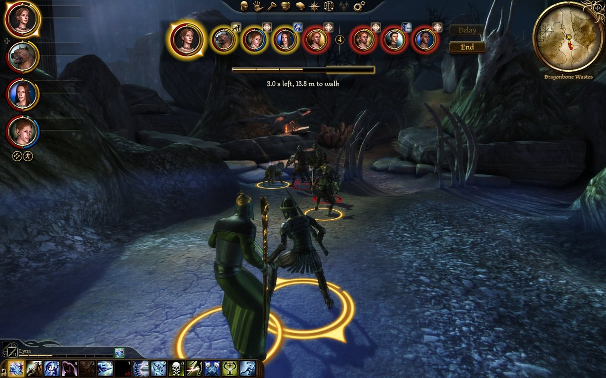

# DAO Turn-Based

Turn-based combat for **Dragon Age: Origins**, Awakening and Witch Hunt: a [DAOLib](https://github.com/Whocares66-Dev/DAOLib) plugin. When a fight starts, everyone rolls initiative and acts one at a time. Talents, spells, enemies and difficulty are unchanged.



## Features

- **[Turns](https://whocares66-dev.github.io/DAOTurnBased/turns/)**: each turn is 4 seconds to spend on attacks, abilities and movement, each at the time the game takes for it. Unused time rolls over to the next turn.
- **[Portrait bar](https://whocares66-dev.github.io/DAOTurnBased/portrait-bar/)**: everyone in the fight, in the order they act, and what an attack or a move will cost before you order it.
- **[Party control](https://whocares66-dev.github.io/DAOTurnBased/party/)**: play each companion's turn yourself, or let its tactics play it.
- **[Options](https://whocares66-dev.github.io/DAOTurnBased/options/)**: an on/off switch, fight speed and key bindings in the game's own Options menu.

## Getting started

Version 1.05 of the game. The mod is developed and tested on the GOG version. The Steam and EA versions need a large-address-aware (LAA) `DAOrigins.exe`; GOG's is large-address-aware already.

Download the [latest release](https://github.com/Whocares66-Dev/DAOTurnBased/releases/latest) and copy `version.dll` and the `daolib` folder into the game's `bin_ship` folder, next to `DAOrigins.exe`. Saves are not modified. To uninstall, delete `bin_ship\daolib\plugins\turnbased`.

The [getting started guide](https://whocares66-dev.github.io/DAOTurnBased/getting-started/) has the details.

## Docs

**[whocares66-dev.github.io/DAOTurnBased](https://whocares66-dev.github.io/DAOTurnBased/)**: the player's guide (`python tools/build_docs.py --serve` builds it locally; [docs/README.md](docs/README.md) has how it is made).

- [dev/DESIGN.md](dev/DESIGN.md): the rules, and why each is as it is.
- [dev/UI.md](dev/UI.md): the portrait bar and the movement preview, made of the game's own interface.
- [dev/TESTING.md](dev/TESTING.md): how it is checked in the game, and what was seen there.

## What is here

- `src/core`: the rules and the turn state machine, with no game and no Windows, tested in `tests/`.
- `src/game`: everything that touches the engine, through DAOLib.
- `src/plugin`: the entry point and the frame callback.
- `ui/`: the portrait bar's and the tactics page's movies, and a ready-made portrait.
- `tools/`: building, deploying, the movies, the preview's art and the docs site.
- `docs/`: the player's guide.
- `dev/`: the docs above, and `DAOLIB_NEEDS.md`, what the mod needs from DAOLib next.
- `extern/DAOLib`: the library, as a submodule.

## Building

Visual Studio 2022 with the C++ workload, [vcpkg](https://github.com/microsoft/vcpkg) with `VCPKG_ROOT` set, and Python 3. Everything is 32-bit, as the game is.

```powershell
git submodule update --init --recursive   # DAOLib, and its address library
python tools\movie.py                     # the two movies (needs Java and JPEXS FFDec)
python tools\reticles.py                  # the movement preview's art, made from the game's own files
.\tools\build.ps1 -Preset debug -Test     # the plugin, DAOLib's loader, the tests
.\tools\build.ps1 -Preset release -Test   # what the game plays
.\tools\deploy.ps1 -Preset release        # into the game (with the game closed)
.\tools\deploy.ps1 -Remove                # take it out again
```

Logs and `turnbased.ini` are in `Documents\BioWare\Dragon Age\daolib\`.

## Working on DAO Turn-Based

[CLAUDE.md](CLAUDE.md) has the project's rules: the one architectural rule, the checks before a commit and before a merge, and how a change is seen in play.

## License

GPLv3 ([LICENSE](LICENSE)), as DAOLib. `src/plugin/EluvianAPI.h` is Eluvian's header, MIT.
