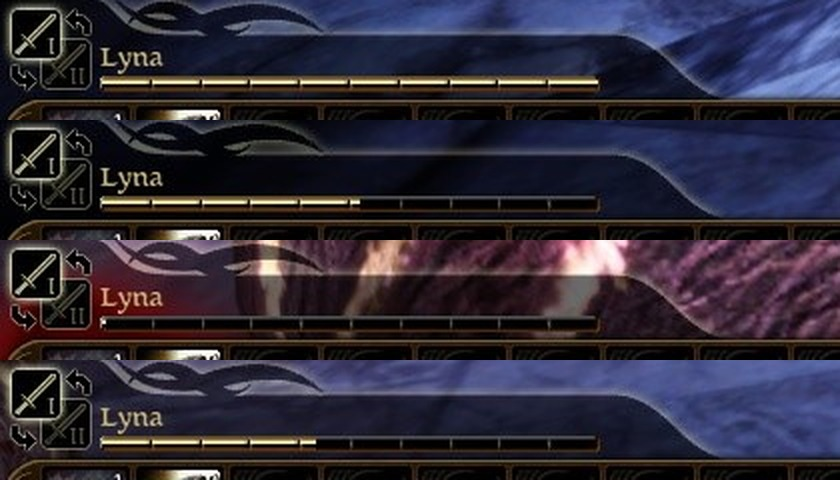

# Play test 26, 2026-10-02 night: the bar's rules in play, and three ways of fighting measured

Nine games on `rebalance-issue-1`, played with no hands by `tools/timeplay.py` through Eluvian's bridge as `turn-based-agent`, each claiming the game, loading Lyna's `AutoSave_2` (never saved), and quitting: 02:12 to 03:10. `turnbased.ini` put back to `clock = actions` (and `enabled = true`) after each. Logs `build\timeplay-<scenario>-<clock>-turnbased.log`, transcripts `build\timeplay-*.txt`. No warning or error but one `still at a attack after 12000 ms: stopped`.

The builds: `6c7edf5` for the first four (the bar as first built), then the working tree that became this commit (the approach, the vanished target, cooldowns on the clock, holds by their time; DAOLib `eb2ade1`).

## The bar (`--scenario bar`, on `6c7edf5`)

1. **Combat Tactics: pass.** Its four ranks given to Lyna (`script AddAbility 100110..100113`): `a bar of 5.00 s`.
2. **Rollover: pass.** One swing, then the turn ended with 3.50 s left: `2.00 s rolls over` (rank 4's cap), and her next turn is `a bar of 7.00 s`: four swings and a fifth kept.
3. **A move too far is refused, one in reach paid as walked: pass.** 40 m off: `Too far (move to location: 47.4 m to walk, 22.0 m left)`. 3 m: 4.50 to 4.03 s (2 m after the free one, at 4.66 m/s).
4. **A kept attack whose target is gone still cost what it owed: the finding.** Its target killed (`stage kill`) before her turn: `a bar of 5.00 s, 0.50 s of it paid for its pending attack`, then `the target of its charged cast of ability -1 (0x3c2) is gone: not cast, nothing spent`: 4.50 s to play with. Mended in this commit: the game layer tells the machine, and the half second is back (`Lyna's pending attack is dropped: its target is gone; the 1.00 s it owed given back`, seen in the third duel below).

## Three ways of fighting, measured (`--scenario duel --clock time|actions|off`)

The same fight each way: Lyna (dagger) and Tamlen (longbow) against the first hall's spiders and spawned ones, every party member attacking the nearest hostile whenever it may, nobody healed, to the end. One fight each: numbers to steer by, not statistics.

| Against | The way | On the clock | Rounds | The party at the end |
|---|---|---|---|---|
| six spiders | the bar of time | 246 s | 9 | both down, one spider killed |
| six spiders | one action a turn | 420 s (stopped) | 27 | Lyna down, Tamlen at 7%, two killed |
| six spiders | real time, the mod off | under a minute | | both down, one killed |
| three spiders | the bar of time | 118 s | 7 | Lyna 30%, Tamlen 97%: won |
| three spiders | one action a turn | 148 s | 16 | Lyna 97%, Tamlen 72%: won |
| three spiders | real time, the mod off | 37 s | | Lyna 63%, Tamlen 49%: won |

What they say:

- **On the bar a fight costs about what it costs in real time.** Three spiders took 28 s of the fight's own time (seven rounds of 4 s) against 37 s in real time, and about three quarters of one character's health against nine tenths. Six spiders wipe the party both ways, in about the same time of the fight's own. That is the brief: a way to play the same game, not an easier one.
- **One action a turn is a different, easier game**: more than twice the rounds, and a third of the damage taken. Each side gets one blow a turn where the bar gives a dagger 2.7 and a spider 2: the party's two ranged and fast attackers lose the most by it, and so do six spiders.
- **The bar takes three times the real time to watch** (118 s against 37 s), at about four seconds a turn, and less than one action a turn does (148 s). Pillars' complaint is pace: the levers are enemies' turns at `ai_turn_speed` above 1 and whatever waits between turns can go, before any change to damage.

**Found in the six-spider fight on the bar** (on `6c7edf5`), and mended in this commit: a spider 13.6 m off was charged its swing as its attack was let through (an AI's walk was not known to the gate), walked, was stopped a step short as its time ran out, was given the swing back and lost its turn, `1.00 s rolls over`. Now an AI's attack is measured as the player's is; a walk and a swing that do not both fit are told apart: the creature walks to its target this turn (`it walks to its target now`) and the swing lands on its next.

## Holds by their own time (`--scenario stun`, on this commit)

Eluvian's `stage effect stun` for a set number of seconds; `dao::effects::On` reads them (its first use in play).

1. **The seconds are read: pass.** `held: [{'name': 'Giant Spider', ..., 'owed_ms': 6000}]`, and Lyna's `'owed_ms': 2000`.
2. **Six seconds: a turn lost and half the next: pass.** `turn_lost` with 2000 ms still owed, then a turn begun with half its bar (12.3 m to move against 23.6).
3. **Two seconds between her turns: half her next bar: pass.** `Lyna's next turn: 2.50 of 5.00 s`: her bar was 5 s with a second rolled over, and the stun's 2 s of her 4 s clock are half of it, as the rule says. The turn after: whole.
4. A spider's pending attack is dropped as it is stunned (`action_dropped ... held`).

## A caster, an archer and an ogre (`--scenario mixed`, on this commit)

Spawned beside the hall's spiders through Eluvian (`stage spawn` with templates from outside the area: `hurlock_emissary_off`, `bandit_human_archer`, `ogre_default`), the party kept alive, six rounds watched.

1. **Each uses its bar: pass.** The emissary, a lieutenant: `a bar of 4.50 s` (Combat Tactics by rank), an ability and an attack a turn, the next attack kept and landing on its next turn. The ogre, the same bar: an attack and an ability, or two abilities. The bandit: two shots a turn. Nobody stalled, nobody chose nothing; no warning in 1,498 lines.
2. **A cooldown lifts mid-turn: pass.** `Ogre's ability 90066 is ready again` between two of its actions.
3. **Finding: an archer that walks for its shot loses the turn.** The bandit's shot was charged as it was let through (its walk to a bow's reach is nothing), then it walked 10.7 m for a line of sight on the 2 s it had left, was stopped, given the shot's time back, and its turn ended: `Bandit is out of movement (10.7 of 19.6 m); the action it was moving for is kept`, `1.00 s rolls over`. One of its three turns. The same shape as the spider's in the duel, for a walk the gate cannot foresee: an action's time should be taken when its creature gets there, not before. Next.
4. Everything but a humanoid's melee swing is on stand-ins still: the ogre's and the spiders' attacks, the emissary's casts and the bandit's shots at 2 s.

## The time on the game's own experience bar (`--scenario look`, on this commit)

The user, 2026-10-02: "Can we not reuse the gold experience bar already in the game?" The bar over the quickbar is a clip of the quickbar's movie, `XPBar_mc`, with a `SetValue(current, max)` of its own; the mod sets it from the turn bar's poll (`src/game/Bar.cpp`, DAOLib's `Movie::Invoke`, its first use on another movie from an `ExternalInterface` handler) and hands it back with the bar's own `UpdateXP` as the fight ends. The game's own frames, through Eluvian's `screenshot`:

1. **Full as her turn begins** (`the game's experience bar shows the turn's time: set (4000 of 4000 ms)`).
2. **Down to 1.78 of 4.00 s after a walk and a swing**: four and a half of its ten ticks.
3. **Empty on a spider's turn.**
4. **Her experience again after the fight** (`the game's experience bar is the experience's again: updated`). The first build hid the turn bar's movie the moment the fight ended, its poll never came again, and the bar stood empty; the movie now stays until it has given the bar back.

The caption under the medallions reads "4.0 s left, 19.6 m to walk" (`images/time-bar-after-a-swing-2026-10-02-26.jpg` has the whole screen). Not yet there: what the order under the cursor would cost drawn on the bar itself.

## Still to see

A talent, a spell and a potion on the bar by the player; the cost of what the cursor is on, the feel of a turn and the pace of a fight (the tester's eyes and mouse: play test 27, asked for); a cooldown's sweep in the quickbar.
