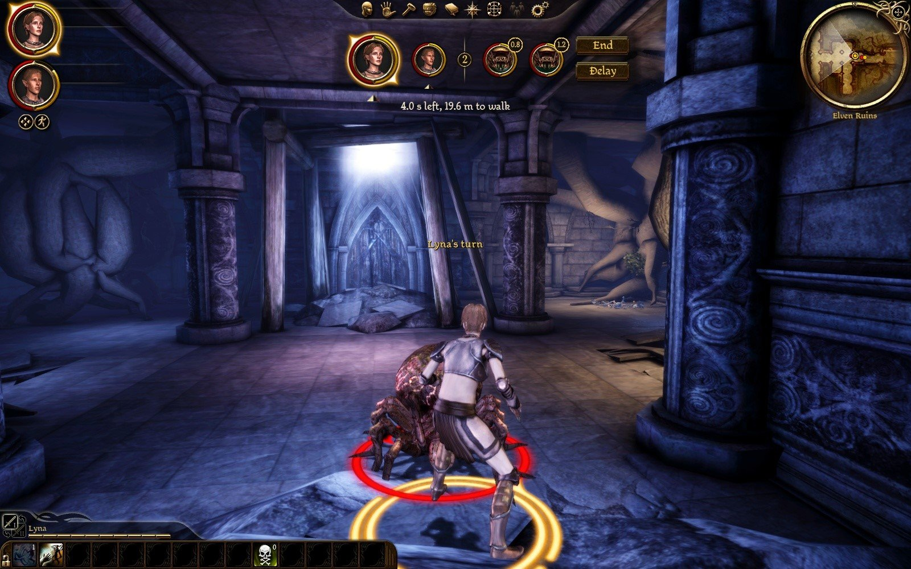
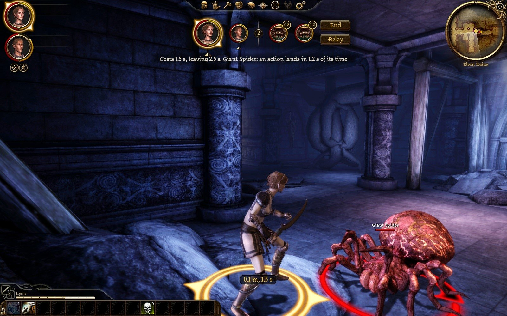
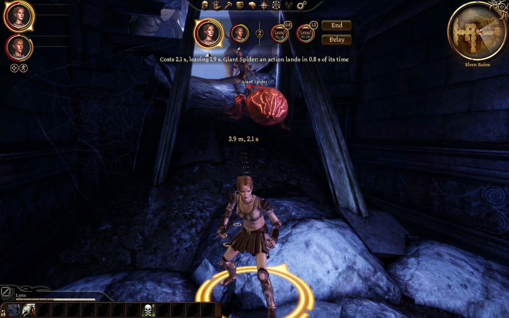
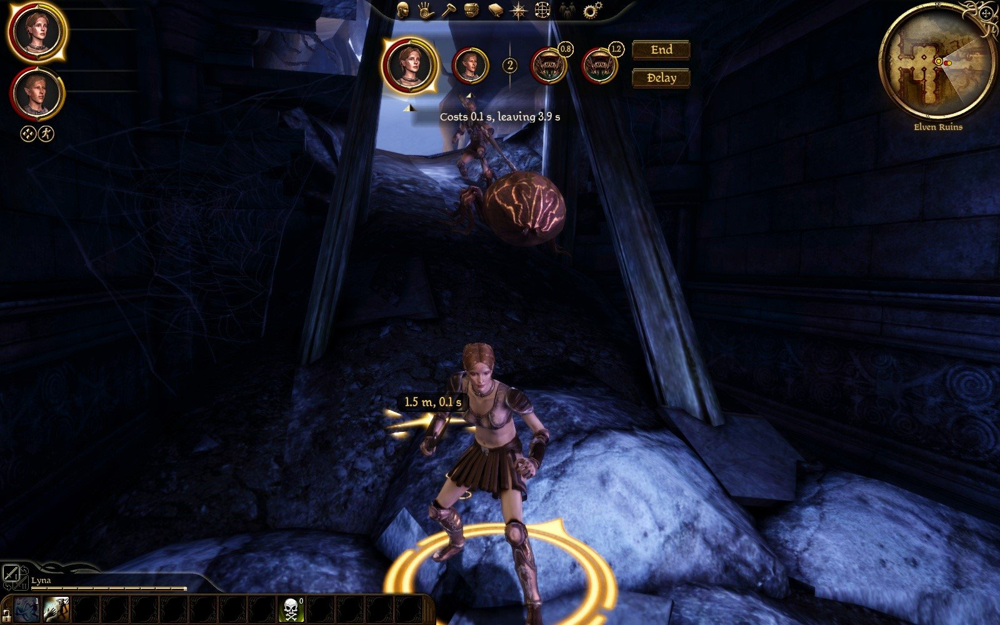
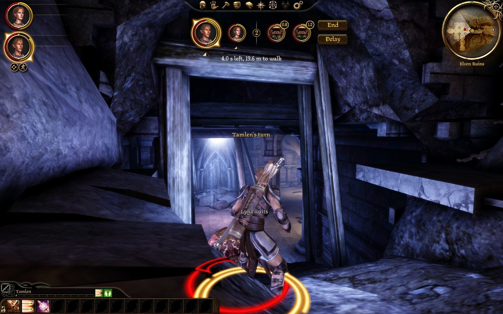
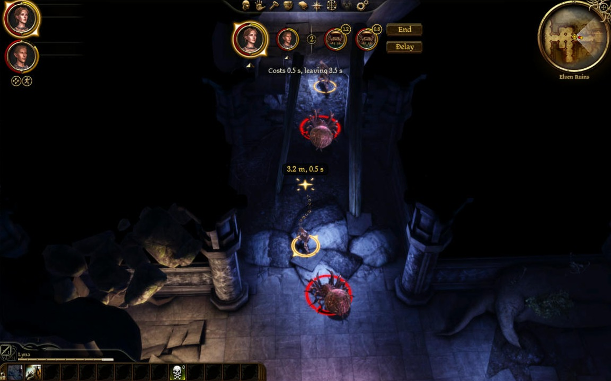
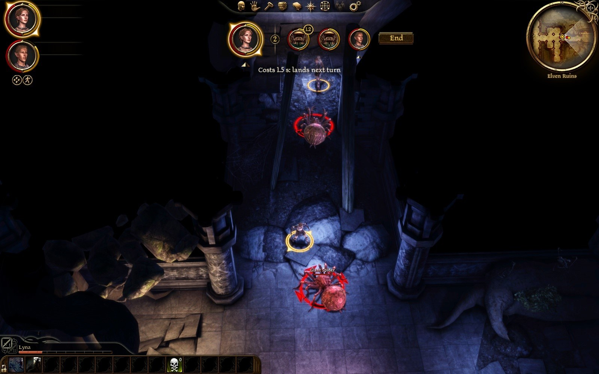
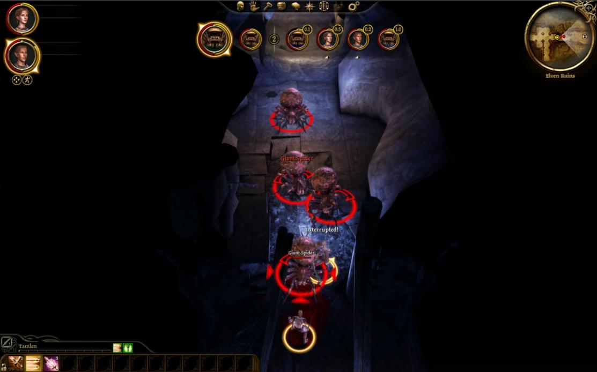
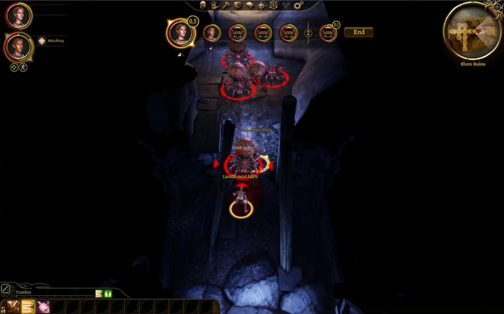
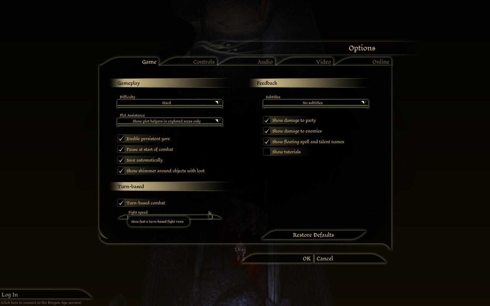

# Play test 28: the fifth and sixth slices, played with no hands (2026-10-02)

Branch `rebalance-issue-1`, the build of the sixth slice (Delay, the cost on the game's bar, the creature under the cursor), on DAOLib `c109566`; Eluvian's plugin with its new `pointer` tool. `[turns] clock = time`. Lyna's autosave 2, loaded only. Played by `tools/timeplay.py` through Eluvian's bridge, five runs between 10:22 and 10:40: `hover`, `mixed`, `interrupt` (three times, as the scenario was made to find a spell that is kept). No hands and no eyes but the game's own screenshots, which the session read. The tester has not seen this build.

The morning's runs did not start: the game crashed at "Initialize - Graphics". Not the mod, and not a sleeping display as first thought: the install's data folders had been emptied at 04:20 by another session's removal of an old worktree whose copy of the game was junctions into the install. The user repaired it in GOG Galaxy; the first good start was 10:13.

## What was seen

| | |
|---|---|
| **The mod's script in the quickbar's movie** | `the quickbar's movie (240740 bytes) is opened: the mod's script is added to it`, every start. DAOLib's `AppendDoAction` through `OnMovieLoad`, first used here. |
| **An order's cost on the experience bar** | Drawn: `an order's cost is marked on the game's experience bar: drawn (1500 of 4000 ms left)`. In the pictures the last 1.5 s of a full 4 s bar is pale for a dagger's swing on a spider in reach, the last 2.1 s for one 3.9 m off, a sliver for a step of 1.5 m; where the pale begins is where the gold would end. |
| **The caption** | "Costs 1.5 s, leaving 2.5 s. Giant Spider: an action lands in 1.2 s of its time": the cost, and the pending action of the creature under the cursor (the spider had begun a bite its bar did not hold). "Costs 0.1 s, leaving 3.9 s" for the step; "4.0 s left, 19.6 m to walk" on nothing. |
| **The cards' pending badges** | 0.8 and 1.2 in their gold rings on the two spiders' cards. |
| **Delay** | The button under End, in the inventory's leather as End is. `turnbased_delay`: "Lyna waits", Tamlen's turn, the bar's order Tamlen, Lyna, then round 2; her turn came in round 1 with 4.00 of 4.00 s and `can_delay` false. Log: `Lyna's turn is put off to the round's end, nothing of it spent`. |
| **Durations** | A giant spider's bite 1.49 s (was the stand-in's 2.0), an ogre's swing 2.40 s, a bandit's and Tamlen's shot and an emissary's staff 1.40 s, Lyna's dagger 1.50 s, an emissary's Drain Life and Weakness 0.84 s for it and 1.12 s for Lyna, an ogre's special 3.89 s. Chain Lightning 4.99 s and Inferno, Tempest and Blizzard 3.99 s with their conjuring: kept on a 4 s bar and landed on the next turn. |
| **An action's time taken on arriving** | `Giant Spider's walk runs past its bar: its attack's 1.01 s goes to the walk, and is taken when it gets there`, then `Giant Spider is at its attack: its 1.49 s taken now, 0.47 s of it owed to its next turn`. |
| **An ogre's grab** | Charged the time it ran: 15 s of it, the ogre's next two turns "spent on its pending use ability" and 0.68 s of the third. |
| **Damage heard, and the threshold** | `0x82 struck for 7 by 0x305 with a spell pending (threshold 16): it holds`, eight times: spiders' bites of 7 and 8 on Lyna with a spell pending, her threshold 16 (Combat Training's first rank, 5, and half her level). Each spell landed. **Not seen: a blow over the threshold**, so an interruption itself is still unseen; it wants something that hits harder than a weak spider. |
| **A mixed fight, six rounds** (two spiders, an emissary, a bandit archer, an ogre) | No warning, no error, no turn that took too long; 27 turns ended "done", 8 by the player, 4 with nothing left, 2 charging, 1 out of movement. Enemies take two or three actions a turn: a spider two bites and a third begun, an emissary two bolts and a spell. |

## What was found, and made of it

1. **The experience bar was empty on Tamlen's turn after Lyna's Delay** (the last picture: "4.0 s left" in the caption, no gold under his name). The game sets the bar to the selected character's experience as the selection changes, and the mod set it only when its own numbers changed, which from Lyna's 4.0 of 4.0 s to Tamlen's they had not. Set twice a second now, changed or not.
2. **A plate "0.1 m, 1.5 s" at Lyna's feet** for an attack on a spider beside her: a walk under half a metre is no walk, and nothing is drawn for it now; the cost is said as before.
3. **`inspect abilities` on a creature just spawned is empty** for a frame or so (Eluvian's note): the scenario waits before it reads.
4. **Nothing in the log said that a staff's bolt or Drain Life on a caster with a spell pending had been heard**: said now, at debug, with its damage type.

## A second look, the same morning (commit `f0c9e7c`, deployed 10:44)

- **The two mends, seen**: after Lyna's Delay the gold bar is full on Tamlen's turn; with the cursor on the spider beside her there is no plate at her feet, the caption and the pale part of the bar as before.
- **A blow over the threshold interrupts** (the `interrupt` scenario with an ogre, 10:46): Lyna cast Chain Lightning as her turn began (4.99 s: kept, 0.99 s owed); the ogre walked up and struck her for 23, her threshold 16. `Lyna is struck for 23 (over 16) with a spell pending`, `Lyna's pending use ability is dropped: struck`, `0x82 struck for 23 by 0x3c2 with a spell pending (threshold 16): interrupted`. The spell never landed. The same run had the ogre's walk run past its bar and its 2.40 s swing taken as it got there, three times.

## Still to see

The speed's slider in the options. An aimed talent's cost in the caption (the quickbar is a movie, which `pointer` does not reach). All of it by the tester's eyes: is the pale part of the bar read at a glance, is Delay where the hand looks for it, do enemies' turns drag at speed 1.

# By the tester's mouse and eyes (10:48 to 11:00)

GOG game (repaired this morning), `turnbased.dll` of 10:40:56 as deployed (branch rebalance-issue-1, f0c9e7c; not redeployed), `eluvian.dll` of 10:24:35. Lyna's `AutoSave_2`, loaded only, nothing saved. `[turns] clock = time` for the test; `speed` went to 2 through the Options slider for one fight and was set back; at the end `clock = actions`, `speed = 1`. Lyna on her Dar'Misu, Tamlen on his longbow. Three fights: the hall's two spiders by mouse (then finished by orders), four spawned spiders at 2x by orders, four at 1x by orders with looks at the screen. No warning or error line, no crash. Log: `build\playtest-2026-10-02-28-turnbased.log`; the 1x fight's timeline: `build\playtest-2026-10-02-28-fight3-1x.txt`. Pictures: `dev\images\time-*-2026-10-02-28.jpg` (nine).

### Worst first

1. **"Lyna waits" was not seen.** Delay put her turn off and Tamlen's began, but the log has her floaty at 10:49:50.975 and Tamlen's turn 18 ms later, and the camera had left her by my first look half a second after the click: all I saw was "Tamlen's turn". And nothing on the bar marks her as waiting: her card is simply second, after Tamlen's.
2. **End moves when Delay goes.** With Delay shown, End is at the top (y 138 in my frame) and Delay under it (170); once the creature has acted Delay vanishes and End drops to the middle (153). My click on End where it had been a moment before hit nothing. A button the hand returns to every turn should not move; leave Delay's place empty (or greyed) instead.
3. **Floaties pile up in a crowd.** With four spiders round the party I saw "Tamlen's turn", "Giant Spider" (a name label) and "Lands next turn" on top of each other, and "Lands next turn" over "No action left" (`time-four-spiders-floaties-stacked`). In the two-spider fight "Lands next turn" stood alone over her and was easy to read (`time-lands-next-turn-floaty`).
4. **The game's own "Interrupted!" and yours.** The game floats "Interrupted!" (white) over a party member whenever a bite breaks their animation; I saw it three times in ordinary play with nothing kept or lost (the log has no "interrupted" line). A player cannot tell that one from the mod's "Interrupted" that means a kept spell is gone. A different word for the mod's ("Lost: Chain Lightning") would separate them.
5. **The caption's second sentence makes a long line**: "Costs 2.1 s, leaving 1.9 s. Giant Spider: an action lands in 1.2 s of its time" ran about 580 px of the 1600, wider than the four cards and the buttons above it. It was readable, but it is two thoughts, and "of its time" needed a second read. "Giant Spider strikes 1.2 s into its turn", or the second part on its own line, would be quicker.
6. **The gold numbers on the cards are small**: "1.2", "0.8", "0.5" in a ring at the card's corner are about 10 px tall at 1600x1000. I could read them in a zoom, not at a glance. With four spiders every card had one (`time-four-spiders-cards-numbers`), which makes them noise rather than news.
7. Quickbar and name plate still show the previous party member on the first frames of a turn (seen again: "Tamlen" under Lyna's turn in `time-four-spiders-floaties-stacked`).

### By item

**1. The gold bar.** On Lyna's full bar: ground 3.2 m off, a sliver at the right end turned pale; spider in reach, the right three eighths; spider 6.1 m off (3.7 m of walk), a little over half (`time-hover-spider-far-pale-bar`); ground 6.1 m off, about a quarter. The pale is a cream white and stands out well against the gold: not too faint, not too bright. With 1.0 s left and a 1.5 s swing under the mouse all that was left turned red (`time-red-bar-lands-next-turn`); unmistakable. It reads at a glance once you know to look at the bar, but the bar is 4 px tall at the bottom left and the mouse is in the middle of the screen: I read the caption first every time and the bar second. The bar is the confirmation, the caption the message.

**2. The caption.** "Costs 0.5 s, leaving 3.5 s" with the path's tag "3.2 m, 0.5 s"; "Costs 1.5 s, leaving 2.5 s. Giant Spider: an action lands in 0.8 s of its time"; "Costs 1.5 s: lands next turn"; Tamlen's bow "Costs 1.4 s, leaving 2.6 s". The new words cannot be misread; that fixes play test 27's complaint. Dirty Fighting aimed at a spider in reach was quoted "Costs 1.5 s, leaving 2.5 s" and charged 1.51 s (4.00 to 2.49 in the log), so the quote was right; since the talent and the swing now cost the same I could not tell from the screen whose price it was. After the stun the spider's card lost its number (its pending bite dropped: "is held ... 7.2 s of its time").

**3. Delay.** The button stands under End at the start of Lyna's turn in round 1 (`time-turn-start-end-delay-ground-near`). Clicked: Tamlen's turn began at once with his full bar and his own Delay; I ended his turn; hers came back with the whole bar (4.0 s, 19.6 m) and no Delay; after Tamlen's first shot his Delay was gone too. Round 2: Tamlen, last in the round, had no Delay, which is right. Where the hand looks: yes, beside End is where I looked. Too easy to hit by mistake: the two are 32 px apart centre to centre and the same size and colour; I did not mis-hit, but see finding 2: because End moves, the place where Delay was is 17 px from where End now is. The order on the bar while she waits read right (Tamlen, Lyna, the round's marker, the spiders), but only because I knew; see finding 1.

**4. The kept action's beat.** 0.81 s in the log between "begins attack ... lands on its next turn" and the turn's end. In a capture 0.2 s after the click "Lands next turn" stood over her and her card had gained a ringed 0.5; by the next capture the camera was on the spider. Long enough to read when she stands clear; I would not make it longer. In a crowd it is not the length that fails but the pile of floaties (finding 3).

**5. The bar between turns.** No flicker: the log's "experience bar is the experience's again" appears only at the three fights' ends (10:52:31, 10:55:46, 10:59:32). Full gold on Lyna's turn right after Tamlen's and on Tamlen's after Lyna's. A turn ended with time unspent rolls 1.0 s over: Tamlen's and Lyna's next bars were "5.0 s left, 24.3 m to walk", and the bar showed full. Nothing says why it is 5.0.

**6. Fight speed.** Options, Game tab, left column under Gameplay: "Turn-based" with the checkbox and a "Fight speed" slider at 1x; two clicks on its right end gave 1.5x and 2x, tooltip "How fast a turn-based fight runs" (`time-options-fight-speed-2x`). OK wrote `speed = 2` to the ini. A whole fight at 2x, four spiders: a spider's turn 1.9 to 2.9 s, a round 17 to 18 s while all four lived, the fight 119 s over 9 rounds. Enemy turns do not drag at 2x. As in play test 27 I saw stills, not motion: whether bites at 2x look silly is still the user's to say. By the clock I would ship 1.5x or 2x as the default; 1x is long (below).

**7. Feel with four spiders.** At 1x a spider's turn is 4 to 6.4 s (it lands the owed bite, bites, bites again or walks, and begins another), so four in a row are 19 to 21 s of watching, and a round is 28 to 30 s with my orders given at once (rounds began 10:56:39, 10:57:08, 10:57:36, 10:58:03). The fight took 203 s over 9 rounds. That is too long to sit through: two thirds of every round is spiders. At 2x the same round is 17 to 18 s and felt (by the clock) like play test 27's two-spider round at 1x. Harder than play test 27: there Lyna lost about 15 health to two spiders in a whole fight; here against four Tamlen went from 115 to 28 in four rounds at 1x and my script set him back to full twice (he would have fallen in round 5), and at 2x Lyna went 84 to 44 in four rounds. Some of that is four against two, but each spider now bites two or three times a turn (the log: three "attack" lines and a "begins attack" in one turn at 10:59:01 to 10:59:05), so four spiders are eight to ten bites a round against the party's five or six swings.

**8. End and Space.** Both end the turn ("end turn pressed", "ended by the game's pause message" for Space). End: see finding 2 for the click that missed.

**9. The ogre and Chain Lightning.** Not done, as you said to skip it.

### Fixed since play test 27, seen

- No "Out of movement" over a walk that arrived in my mouse play (the log has 4 "out of movement" lines, all in the fights played by orders; I did not look at each).
- "The refused attack" is in the log 10 times in the whole session, not 29 in one second.
- The experience bar does not flicker mid-fight.
- The pending action is on its creature's card (a ringed number), and the stunned spider's went away.
- The caption's words.

### Not done

- Speed 2 by mouse, and any judgement of how 2x looks in motion.
- The red bar and Delay on Tamlen (seen on Lyna only); Delay pressed in a later round.
- 0.5x and 1.5x played.

## What was made of it, and of the user's look at the pictures

| Found | Made of it |
|---|---|
| 1. "Lyna waits" never seen | Her card says "waits" until her turn comes. |
| 2. End moves when Delay goes | The two keep their places through the turn; Delay is greyed when it is not to be had. |
| 3. Floaties pile up in a crowd | Not acted on. |
| 4. The game's own "Interrupted!" and the mod's | The mod says "Spell lost" or "Action lost". |
| 5. The caption's second sentence | The cost alone when an order is priced; the pending action is said when none is, and under the pointer on the card: "X lands 1.2 s into its next turn". |
| 6. The ringed numbers small, and on every card | The user: the number "doesn't really tell us anything": the pending talent's or spell's own icon, no ring, a soft light behind it, three quarters the first size; nothing for a pending attack. |
| 7. Quickbar and name plate a frame late | The game's own; not acted on. |
| A bar of 5.0 s with no word of why | "(1.0 s saved from last turn)" while the turn is whole. |
| The cost on the experience bar: read after the caption, the bar 4 px tall | The user: the time on the experience bar "replaces the experience bar? that's confusing. we should have it separate": the bar of time is the mod's own, under the turn order, of the experience bar's art, three times as tall on the screen. |
| Space ends the turn | The user: "space bar should still pause the game": it pauses; End turn has Enter. |
| Enemies' turns at speed 1: two thirds of a round | For the user to see in motion: `[turns] speed` and `ai_turn_speed` are there, and the options' slider. |

