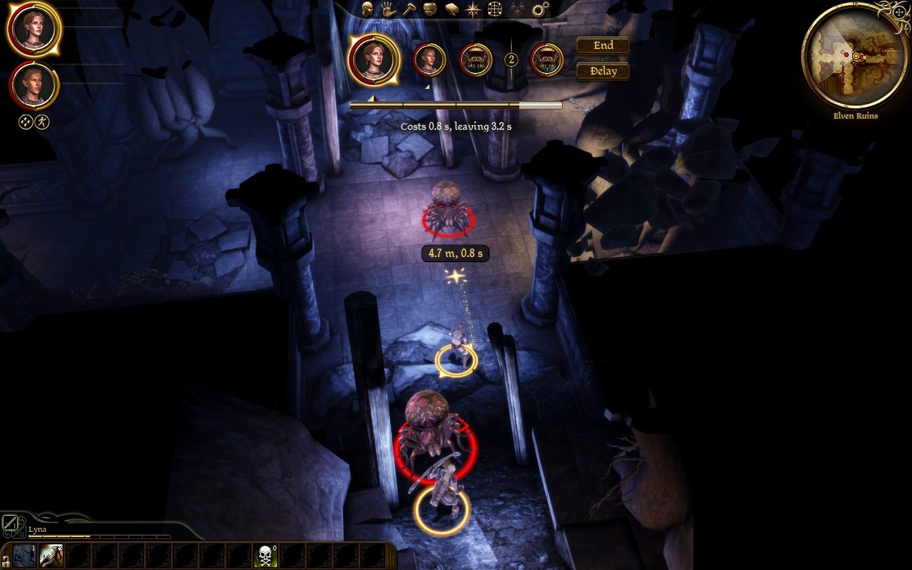
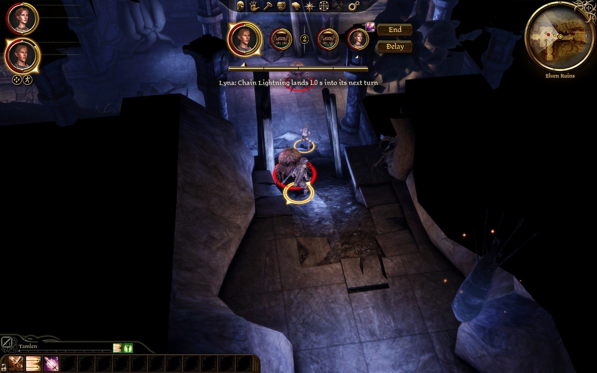
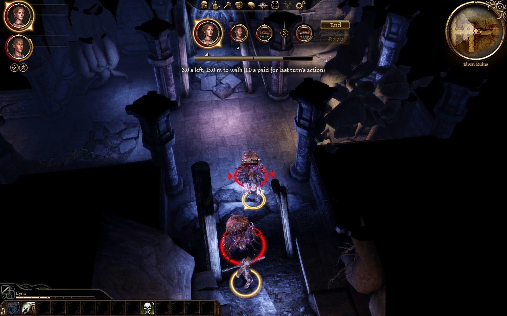
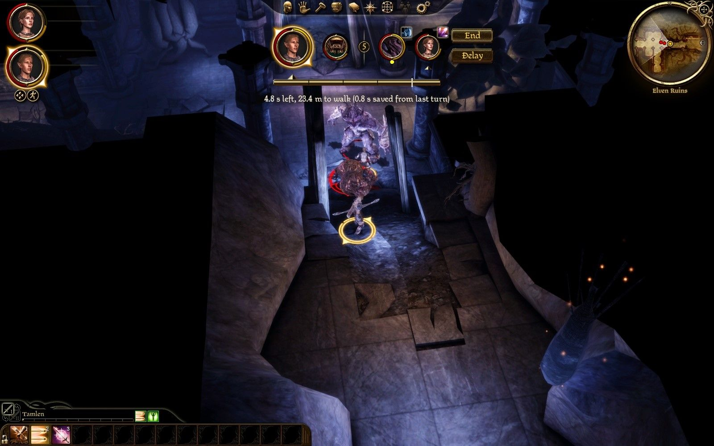
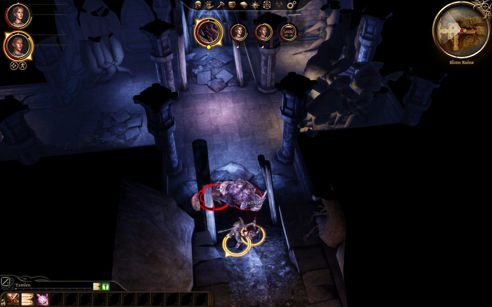

# Play test 29: the bar of time of the mod's own, the pending icon, Space pausing (2026-10-02)

By the tester's mouse and eyes, on the build of the seventh slice before it was committed. Its notes, then what was made of them.

GOG game, `turnbased.dll` of 11:34:25 as deployed (branch rebalance-issue-1, uncommitted; not redeployed), `eluvian.dll` of 10:24:35. Lyna's `AutoSave_2`, loaded only, nothing saved. Settings as found (`clock = time`, `speed = 1`); `ai_turn_speed` set to 2 for the last fight and back to 1. Lyna on her Dar'Misu with Chain Lightning added (`AddAbility 0x82 10211`), Tamlen on his longbow. Two fights: the hall's two spiders with an `ogre_default` spawned beside Lyna in round 3 (mouse for the looks, Eluvian's orders for the casts and Tamlen's later turns; ended with `stage kill`), and four spawned spiders with the enemies' turns at 2x (by orders). One warning in the log, no error, no crash. Log: `build\playtest-2026-10-02-29-turnbased.log`; the last fight's timeline: `build\playtest-2026-10-02-29-fight2-ai2x.txt`. Pictures: `dev\images\time-*-2026-10-02-29.jpg` (six).

## The tester: Worst first

1. **A cast that fitted was charged and I saw nothing come of it.** Lyna's turn of 5.0 s (a saved second), Chain Lightning ordered at the ogre the moment after it was spawned: "Lyna: use ability costs 4.99 s", "0.01 s and 1.1 m left", the cooldown set ("held for 15 of its user's turns"). No "begins", no "lands". Afterwards the ogre stood at 220 of 220, the spiders at 25 and 21 as before, and Lyna's stamina read 0.43 against 0.40 before. The ogre joined the fight 0.45 s after the order ("Ogre joins the fight" 11:44:41.509), so this may be my staging (a target not yet in the fight) and not the mod; but a turn's whole time went for nothing visible. Worth one no-hands run: a 4.99 s spell in a 5.0 s bar at a target already fighting.
2. **A turn with 0.01 s left does not end.** After that cast the turn stood at "awaiting order" with 14 ms and 1.1 m; the bar was all dark, there was no caption at all under it, and nothing happened for the 30 s I watched until I clicked End. Either end a turn whose time is under some small amount, or say "0.0 s left" so the player knows to press End.
3. **Nothing says the game is paused.** Space paused it (log: "paused by the player") and Space ran it again, three times out of three, on Tamlen's turn, on a spider's turn (two captures 3 s apart identical, the bite went on after) and with an order given while paused (the right-click ran the game and the shot went off). But on the screen the only change I can find is a pair of curled ornaments either side of the turn cards. I did not read them as "paused"; I found them by comparing pictures afterwards. The game's own "Paused" banner does not show. A word is needed.
4. **"Spell lost" is white on whatever is behind it**: here over the ogre's pale body (`time-spell-lost`), small, and not over Lyna but where she had been knocked to. I found it in a frame because I knew when to look. It is the most important floaty the mod has; gold or red, and larger, would suit it. The log: "Lyna is struck for 27 (over 16) with a spell pending", "pending use ability is dropped: struck"; her card's icon went at once.
5. **A stuck enemy attack**: the one warning, "still at a attack after 12000 ms: stopped" at 11:48:01.487 (fight 2, a spider's turn that took 6.1 s on the wall at 2x); another spider turn took 6.1 s in round 3 with no warning. ("a attack" wants "an".)
6. **Lyna's pending icon touches End.** With her card last in the row the spell's icon at its right shoulder sits against the End button's left edge (`time-pending-icon-card-hover`, `time-two-pending-icons-ogre-ram`). Not overlapping, but crowded; the left shoulder would be clear.
7. The caption with an order priced still reads "Costs 1.4 s, leaving 2.6 s"; your note said it would be the cost alone. I prefer it as it is.

## The tester: By item

**1. The new bar.** Under the turn cards, as wide as the four cards (about 370 px of the 1600), a tick a second, gold for what is left, dark for what is spent, pale for what the order under the mouse would spend (`time-new-bar-ground-cost`). This is much better than the experience bar: it is where the eyes already are, between the cards and the caption, and I read it without looking for it. Not too thin (about 8 px), not too wide, not in the way of anything in these fights. The experience bar at the bottom left showed experience all through. A saved second makes it a bar of five ticks with a brighter mark at the fourth (`time-saved-second-bar-of-five`); a turn begun short shows the paid part dark (`time-turn-starts-short-with-reason`). It is hidden on enemies' turns, with End and Delay. I did not make the red case on the new bar this time (no order that did not fit under the mouse); pale I saw on ground, bow shot and after a shot.

**2. Pending actions.** Chain Lightning cast on a 4.0 s bar was kept and its icon stood at the shoulder of Lyna's card; the ogre's Ram and later Smash showed theirs ("its icon is 'eff_ico_ogre_ram'", `time-two-pending-icons-ogre-ram`). At 18 px they read as "this one has something coming" by colour and shape; which spell it is I could tell only for the lightning. That is the right amount: the hover gives the words. The soft light behind worked on Lyna's bright portrait and on the ogre's dark one. Hovering Lyna's card: "Lyna: Chain Lightning lands 1.0 s into its next turn" (`time-pending-icon-card-hover`); clear ("its" for Lyna reads oddly; "her" is not knowable, "their" or just "next turn" would do). Spiders with a pending bite showed nothing, as said. The ogre's card has a yellow dot under it that I did not understand (its rank?).

**3. End stays put.** Clicked at the same place on three turns (Tamlen, Tamlen, Lyna): it ended the turn each time. Delay greyed under it when not to be had.

**4. "waits".** Under Tamlen's card after Delay, in small lower-case type, through the spider's turn (`time-new-bar-ground-cost` is before it; I have it in a capture, not saved from the game: the card row read spider, Tamlen "waits", round marker, spider, Lyna). Small but enough.

**5. Space and Enter.** Space: see finding 3; it never failed to bring the game back. Enter ended Lyna's turn ("end turn" by the key). I did not look in the controls screen for "End turn", and did not try Space between turns as such (the pauses fell inside turns).

**6. Words.** "Spell lost": shown (finding 4). "5.0 s left, 24.3 m to walk (1.0 s saved from last turn)" and "4.8 s left, 23.4 m to walk (0.8 s saved from last turn)": shown and clear. New to me and good: "3.0 s left, 15.0 m to walk (1.0 s paid for last turn's action)" on the turn the kept spell landed. The priced caption: finding 7.

**7. Four spiders, the enemies at 2x and the party at 1x.** A spider's turn 1.7 to 3.0 s (two outliers of 6.1 s, finding 5), a party turn 5 to 6.3 s with orders given at once, a round 19 s (round 1) and 26 s (rounds 2 and 3, each with an outlier), about 20 s when down to three spiders. Against play test 28: all at 1x a round was 28 to 30 s, all at 2x 17 to 18 s. So enemies at 2x takes a third off the round and leaves my own swings at the speed I ordered them, and the share of a round spent watching falls from two thirds to under half. By the clock that is the setting I would ship: it cuts the waiting and not the playing. Whether a spider at 2x beside a party at 1x looks odd in motion I cannot say from stills. Tamlen needed setting back to full once (round 7), as in 28.

## The tester: Seen fixed since 28

- End does not move; "waits" marks who put a turn off; the ringed numbers are gone; a turn begun short or long says why; the bar is no longer the experience bar.

## The tester: Not done

- The red (does not fit) shading on the new bar; the controls screen's "End turn" entry; Space between two turns; a fight at speed = 2 for comparison in this build; the ogre's Grab (it used Ram and Smash).

## What was made of it

| Found | Made of it |
|---|---|
| 1. A cast that fitted was charged and nothing came of it | Its command was over in 0.4 s of the 4.99 s it takes, with no failure reported: the spell never played (its target had not yet joined the fight), and the whole bar was charged. **An action over in under a quarter of the time the engine was read to take for it is given back** (`TurnMachine::OverAtOnce`; a second or more, a time read and not a stand-in's, once a turn, as a failed command's is), its cooldown not held, "Nothing happened" over the player's. `[turns] give_back_unplayed` turns it off. Not yet seen in play: the tester's staging was not repeated. |
| 2. A turn with 0.01 s left does not end and says nothing | It does not end by the rule: an action begun then lands on the next turn. The caption says so now: "No time left: an action begun now lands next turn". |
| 3. Nothing says the game is paused | The caption says "Paused: Space runs the game again", on anyone's turn (the bar's string carries it). |
| 4. "Spell lost" small and white | Red over a party member, gold over an enemy. Its size is the game's floaty's. |
| 5. "still at a attack after 12000 ms: stopped" on a spider's turn | The machine's own guard, as built: a creature that stands at an attack it cannot reach for `max_action_ms` of the world's time is stopped. Not changed; twice in one fight of four spiders is worth a look at what kept it standing. |
| 6. The pending icon against End's edge | End and Delay stand ten pixels further from the last card. |
| 7. The caption's words | As they are: "Costs 1.4 s, leaving 2.6 s". |
| The yellow dot under the ogre's card | A lieutenant's gem, as built (a boss's is orange): under the pointer the card says "Ogre, a lieutenant". |
| Enemies at 2x, the party at 1x: a third off the round | For the user: `ai_turn_speed = 2` is what the clock recommends; how it looks in motion is theirs to judge. The default stays 1. |
