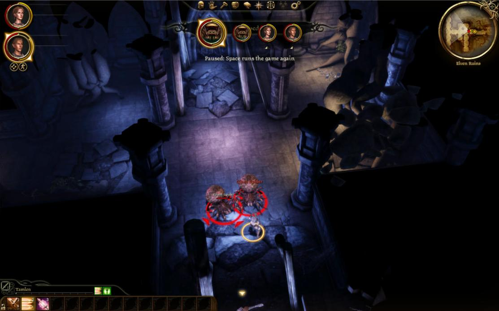
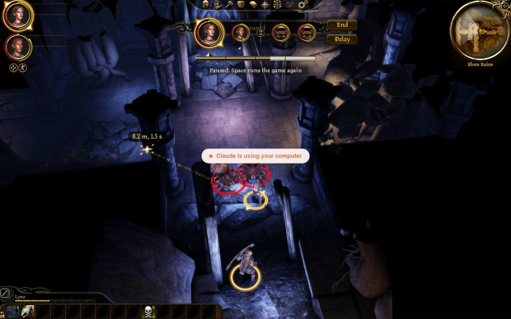
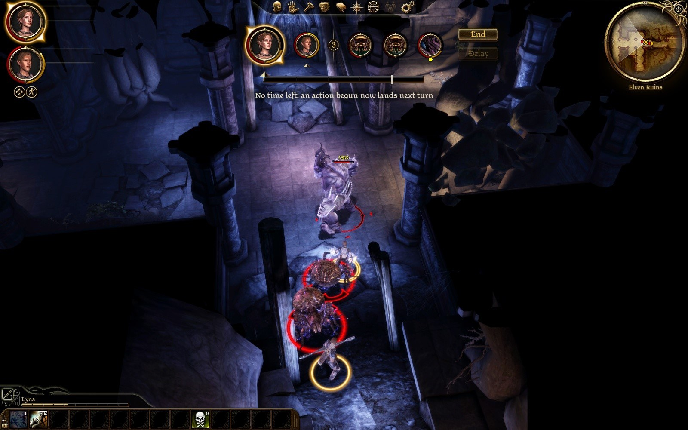
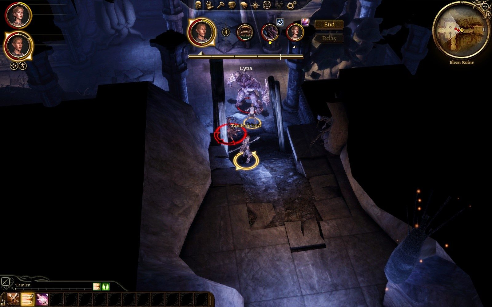
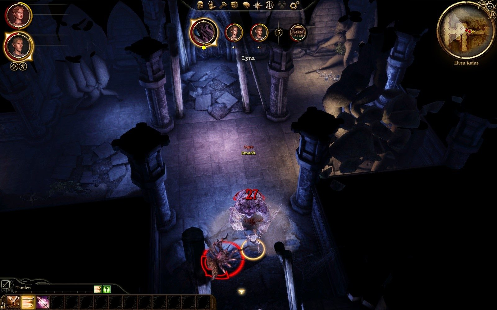
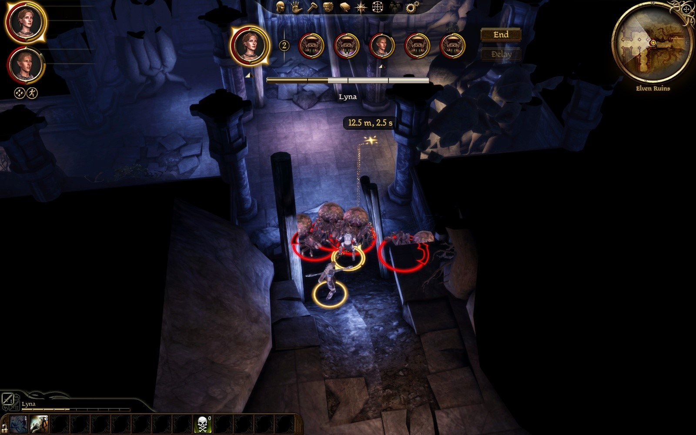

# Play test 30: what play test 29 led to, by mouse, and one speed (2026-10-02)

By the tester's mouse and eyes, on the build of `c70c848` (one speed, the fixes after play test 29). Its notes, then what was made of them.

GOG game, `turnbased.dll` of 12:45:08 as deployed (branch rebalance-issue-1; not redeployed), `eluvian.dll` of 10:24:35. Lyna's `AutoSave_2`, loaded only, nothing saved. Settings as found (`clock = time`, `speed = 1`); `speed` set to 2 for the second fight through `turnbased_settings` (not the Options slider this time: it was seen working in play test 28) and back to 1. Lyna on her Dar'Misu with Chain Lightning added, Tamlen on his longbow. Two fights: the hall's two spiders with an ogre spawned on Lyna's turn in round 2 (ended with `stage kill`), and four spawned spiders at 2x (two party turns by mouse, the rest by orders). No warning or error in the log, no crash. Log: `build\playtest-2026-10-02-30-turnbased.log`; the 2x fight's timeline: `build\playtest-2026-10-02-30-fight2-2x.txt`. Pictures: `dev\images\time-*-2026-10-02-30.jpg` (six).

## The tester: Worst first

1. **Three dagger attacks in a row did nothing, and two of them were charged.** Fight 2, Lyna's turn, 12:58:08 to 12:58:17, my right-clicks on spider `0x48b`, 2.5 m away against a reach of 2.4 m, four spiders packed round her. Each time the log has "0x82: attack ended COMMAND_FAILED" within a quarter of a second of the order. The first was given back ("Lyna's attack failed (over at once: it did nothing): its action is given back", "Nothing happened" over her, 3.71 s left: the 0.29 s of walk stayed charged though she did not walk). The second and third were charged 1.50 s each (2.21 s, then 0.71 s left) with no floaty and no swing; the spider stood at 55 of 55 throughout. So the once-a-turn limit on giving back leaves the player paying for nothing twice, with no word. The caption had priced the first at "Costs 1.8 s" (a walk of 2.3 m) and the others at "Costs 1.5 s" from the same spot. Either the target a hair out of reach in a crowd cannot be attacked (then say so before the click, or refuse the order), or every attack that ends at once should be given back, not the first only. A fourth COMMAND_FAILED of hers is in the part played by orders.
2. **The caption can stick on a name.** After I rested the pointer on the ogre's card ("Ogre, a lieutenant"), the cards changed under it (the ogre's place became Lyna's), and from then the caption read "Lyna" whatever the pointer was on: through the rest of fight 1, the whole of Tamlen's turn in fight 2 (three shots priced on the bar, "Lyna" under it) and into Lyna's turn with the pointer on the ground (`time-caption-stuck-on-lyna`: the path's tag says "12.5 m, 2.5 s", the bar is shaded, the caption says "Lyna"). Putting the pointer on a card again and taking it off cleared it. A card that leaves from under the pointer never gets its roll-out.
3. **"Spell lost" in red is harder to read than it was in white.** Over Lyna it is a dark red, on the ogre's pale body, directly under the game's own large red "27" (`time-spell-lost-red`). I had to look for it in the frame. The colour says "bad" but the size and the darkness lose it; it wants to be as large and bright as the damage number, or to sit under her card instead.
4. **The game's own "Paused" shows behind the turn cards**: while paused, the tail of the game's banner ("...used", "...sed") is visible between the cards (`time-paused-caption-lyna-turn`, `time-paused-caption-enemy-turn`). It looks like a drawing fault. Hide it, or move the cards' row clear of it.
5. **The cast that did nothing did not come back this time**; see item 2 below. Nothing wrong seen, but the fix is unconfirmed by me for a spell (finding 1 shows it firing for an attack).
6. After the ogre's Ram Lyna lost her next turn ("Lyna is held by an effect: its turn is lost", 12:55:30.955) and the turn after began normally. Right by the rules as I understand them; I saw no word on screen for the lost turn (I was not watching that frame; you may have one).

## The tester: By item

**1. Paused.** Space on Lyna's turn: "Paused: Space runs the game again" in the caption's place at once, the bar still shown; Space again and the caption went back to the order's price. Space 0.3 s after ending her turn (as near "between two turns" as my hands get; it fell as Tamlen's turn began): the same. Space on a spider's turn: the same caption under the cards with no bar, the bite frozen (two captures 2.5 s apart identical), going on after. Three of three resumed. Seen at once: yes. The right place: yes, it is where I look for what the game is doing; with finding 4 fixed it would be clean.

**2. The cast that did nothing.** Lyna on a 5.0 s bar, the ogre spawned and Chain Lightning ordered at it 0.3 s later (order 12:54:06.975, "Ogre joins the fight" 12:54:08.060). This time the spell played: she was "executing" for 5.8 s, the cooldown was set at 12:54:12.754, the ogre fell from 220 to 176 and the spiders to 17 and 5. Charged 4.99 s, not given back: correct for a cast that happened. So I did not see "Nothing happened" for a spell, and what differed from play test 29 I cannot say (there the ogre had stood 30 s before the order and joined 0.45 s after it). That run also covers your "opposite" case in effect (a spell that plays costs its time), though the target was the ogre and the spiders took the chain.

**3. "Spell lost".** Chain Lightning kept on a 4.0 s bar (her cooldown cleared by `stage reset`), the ogre's Ram struck her for 28: "Lyna is struck for 28 (over 16) with a spell pending", icon gone. Red over her: finding 3. "Ogre" and "Smash" floated in red and gold at the same time further up, easy to read.

**4. Nothing left.** After the 4.99 s cast on the 5.0 s bar: the bar all dark and "No time left: an action begun now lands next turn" under it (`time-no-time-left-caption`). Clear. (Got by the cast, not by two swings and a walk.)

**5. The pending icon and End.** With Lyna's card last and Chain Lightning pending, her icon stands well clear of End, about 25 px (`time-pending-icon-clear-of-end`); the ogre's Ram icon beside it.

**6. The ogre's card.** "Ogre, a lieutenant" under the pointer. (And then finding 2.)

**7. One speed, 2x.** Four spiders, `speed = 2`. Everyone ran at 2x: Tamlen's shot went from order to the next order in about 1 s, a party turn of three orders 3 to 4 s, a spider's turn 1.7 to 2.7 s, a round 15.6 to 17.8 s while all four lived, the fight 126 s over 10 rounds (the first minute of it mine by mouse). The caption and the bar kept up: each capture after a shot showed the new figures. "Lands next turn" was in two captures about half a second apart after Tamlen's third shot, then the spider's turn had begun: readable, not gone too fast. I saw nothing that reads wrong at 2x on my own turn in stills; the walk I could not judge (finding 1 ate Lyna's). Lyna was set back to full twice (21 and 26 health), so the fight is no easier than before. Speed is back at 1.

**8. Else.** Findings 1, 2, 4 above.

## The tester: Not done

- The Options slider itself this time; "Nothing happened" for a spell; the no-time-left caption reached by swings and a walk; a walk watched at 2x; Space exactly between two turns.

## What was made of it

| Found | Made of it |
|---|---|
| 1. Three dagger attacks did nothing and two were charged | The engine fails the attack itself (`COMMAND_FAILED` within a quarter second: 2.5 m from the spider, but 4.7 m of path round the others). **With time, an action that did nothing is given back every time**, not once a turn, with "Nothing happened" each time (`OnCommandFailed`; as built it stays once a turn, the turn's one action). The walk's 0.29 s stays as meters paid for, which the next walk uses. |
| 2. The caption sticks on a name | A card taken from under the pointer has no roll-out: the hovered name is cleared whenever the cards are rebuilt. |
| 3. "Spell lost" in red reads worse than white | Gold, as the mod's other words are. |
| 4. The game's own Paused banner's tail between the cards | The bar's plate is solid while the player has the game paused; the caption carries the word. (Undone the same day: the user, playing, "pausing makes the background turn black?" The plate is as ever, and the plugin hides the game's banner through a fight instead: `BarLink::HideGameBanner`, not yet seen in play.) |
| 5. The cast that did nothing did not come again | The rule was seen on an attack (finding 1); a spell at a target the game will not take is still unseen. |
| From play test 29: a spider stood five seconds at an attack it could not get to | Read in that test's log: the engine's own attack gave up after ten seconds of the world's time (`COMMAND_FAILED_TIMEOUT`), and the next was stopped a second after it began, the machine's limit counting from the turn's first command. **A creature that stands 2.5 s well short of where its attack's walk was to end is stopped**, its action given back, and its AI chooses again, once ("No way through" over the player's own); and **each command has `max_action_ms` of its own**. Not yet seen in play. |
| Everyone at 2x: a round of four spiders 15.6 to 17.8 s | With play test 28's 28 to 30 s at 1x: the user's to choose. The default stays 1. |
