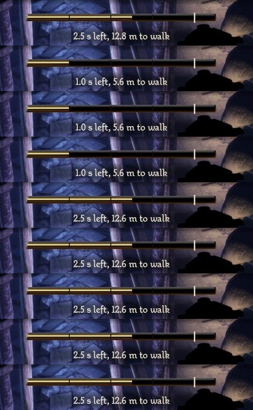
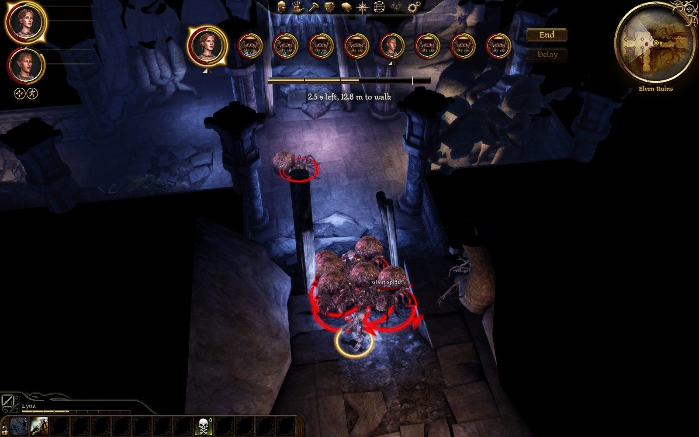
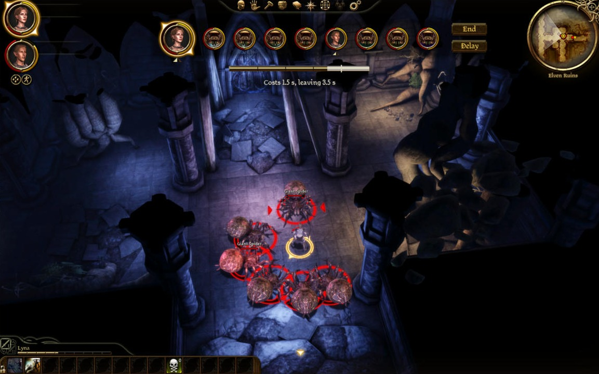
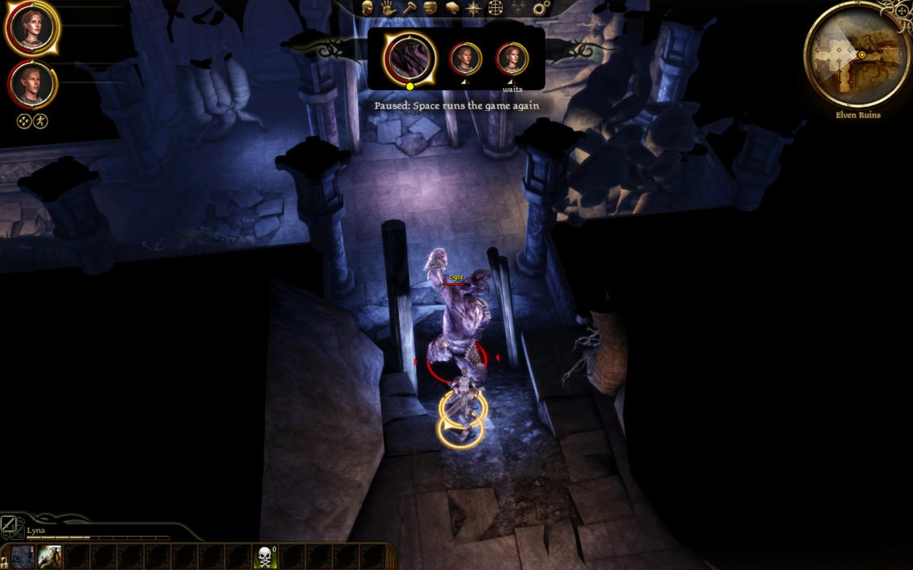
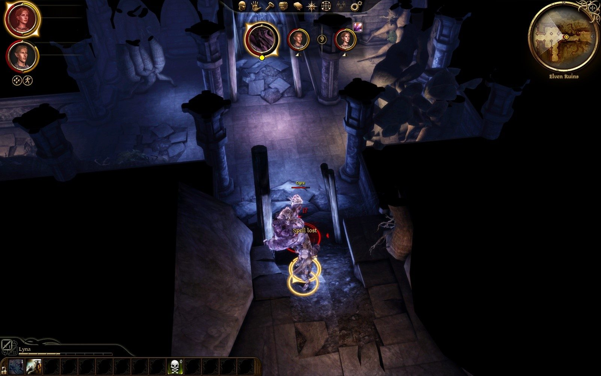
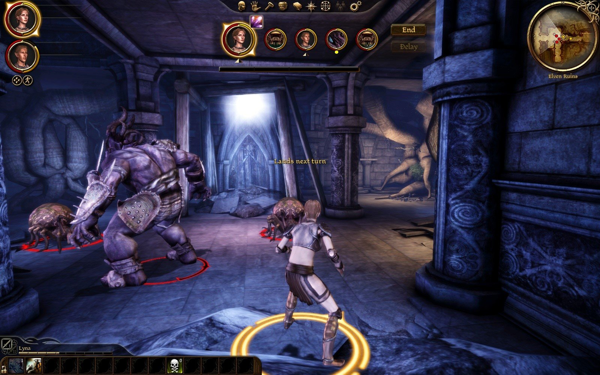

# Play test 31: what play test 30 led to, by mouse (2026-10-02)

By the tester's mouse and eyes, on the build of `caa29e1`. Its notes, then what was made of them.

GOG game, `turnbased.dll` of 13:08:39 (MD5 3ca91de1..., the source at caa29e1) with `turnorder.swf` of 13:40:24, as deployed; not redeployed. Lyna's `AutoSave_2`, loaded with no content dialog, no Force Load; nothing saved. Settings as found and left (`clock = time`, `speed = 1`). Lyna on her Dar'Misu with Chain Lightning, Tamlen on his longbow. One long fight: the hall's two spiders plus five spawned round Lyna (seven in all), then thinned to two with `stage kill` and an ogre added. Lyna fell once at 13:50:57 and was raised with `stage reset`. No warning or error in the log, no crash. Log: `build\playtest-2026-10-02-31-turnbased.log`. Pictures: `dev\images\time-*-2026-10-02-31.jpg` (five).

## The tester: Worst first

1. **A blocked attack is given back, but with no word, and after a long stand.** Lyna ordered (by Eluvian's `order`, as the player's) to attack `0x3c9`, a spider on the far side of the six packed round Tamlen. First try: she walked 9 m (2.0 s of walk), stood, and at 13:53:37.397 "Lyna's attack failed (COMMAND_FAILED_INVALID_PATH): its action is given back", 4.1 s after the order: 4.50 s became 2.50 s, the walk kept, the swing given back. Second and third tries from where she stood: charged to 0.97 and 0.92 s, then back to 2.47 and 2.42 s after 1.5 s and 2.1 s. So nothing was charged for nothing, every time: item 1 passes. But in nine frames a try I saw **no "Nothing happened" and no "No way through"** over her, and the log has no floaty effect at those give-backs; all the player sees is the bar dropping to 1.0 s and coming back a second and a half later (`time-blocked-attack-bar-strip`), with the caption reading "1.0 s left, 5.6 m to walk" meanwhile. The word is missing for this kind of failure (INVALID_PATH), and the caption beforehand quoted an ordinary price.
2. **Spiders' turns are no shorter in a crowd.** 21 spider turns between 13:48 and 13:54 with seven spiders: 2.2 to 6.4 s, mean 4.5 s; eleven of them over 4.5 s. The log has one "stood 2500 ms at a attack without a step: stopped; it cannot get to its target, and its action is given back" (13:51:30.641, in a turn of 5.4 s) and nine "attack failed (COMMAND_FAILED_INVALID_PATH): its action is given back", some two in one turn (13:51:22.7 and 13:51:25.2, a turn of 6.4 s). So the new guard fires, but a blocked spider still takes its 4 to 6 s: it tries, fails after 2 to 4 s, and sometimes tries again. A round of seven spiders and two party members was 60 to 70 s on the clock with my orders given by hand. No turn of 12 s any more.
3. **The ogre's turn ended in 0.2 s with nothing done** (13:59:28.486 to .695): its owed attack "lands", an attack, "move to object", "attack failed (COMMAND_FAILED_NO_SPACE_IN_MELEE_RING): its action is given back", "turn ends: done; 1.50 s rolls over". One spider stood at Lyna's feet; the ogre was 2.6 m from her. A lieutenant passing its whole turn because one ring was full reads as a bug to the player, and it then had a 6.00 s bar next round.
4. **With nine cards the End and Delay buttons run under whatever is beside the row.** Nothing wrong in the mod: the row grew to nine cards and End and Delay moved right to about x 1037 of my 1389 frame, where the Claude desktop app's own window lies over the game on this machine, so my clicks on Delay did not arrive (Windows says the pointer was over "Claude"). Mentioned because the row has no upper width: with a dozen combatants on a 1600 px window the buttons would be near the minimap. The bar of time also stays 370 px wide and centred while the row grows to 780 px, so with nine cards it sits under cards three to six, not under the current one.
5. Lyna lost a turn after the ogre's Ram again ("held by an effect: its turn is lost", 13:55:42.196); her bar that turn read "2.1 s left, 10.9 m to walk" for the two seconds before it was taken. I saw no word for why the turn went.

## The tester: By item

**1. Nothing charged for nothing.** Yes, three times running, each given back: finding 1. The case of play test 30 itself (2.5 m against 2.4 m in a crowd) did not arise: six spiders stood at 2.1 to 2.4 m and all three of my mouse attacks on them landed normally (1.7 s each, damage done). "Nothing happened" was not seen in this test.

**2. A creature that cannot get there.** Finding 2. For Lyna: no "No way through" (finding 1).

**3. The caption does not stick.** With the pointer on Tamlen's card ("Tamlen") I ended the turn by Enter; the cards were rebuilt under the pointer, the caption read "Giant Spider" (the card now there), and with the pointer back in the world it showed prices again on the next party turn ("Costs 1.5 s, leaving 3.5 s" on five spiders in turn). Fixed.

**4. "Spell lost" in gold.** Seen at 14:00:14.9 (struck for 17 over 16): gold, over Lyna, beside a small red "17" (`time-spell-lost-gold`). Read at a glance now; the gold separates it from the game's red and white. It took three tries to stage: once she had a saved second and the 4.99 s spell fitted and played; once the ogre's turn was the 0.2 s one of finding 3.

**5. Paused.** A solid dark plate behind the cards with a curl either side, "Paused: Space runs the game again" under it, no tail of the game's banner (`time-paused-solid-plate-waits`). Clean. "waits" hangs half below the plate's bottom edge.

**6. The arrow and "waits".** The gold arrow sits just under each party member's ring, well clear of the bar (`time-nine-cards-arrow-under-ring`); "waits" in small type directly under Lyna's arrow after Delay (`time-paused-solid-plate-waits`). Both read as the card's own.

## The tester: Not done

- "Nothing happened" and "No way through" seen on screen; the 2.5 m against 2.4 m case; anything at 2x; Delay on a nine-card row (finding 4).

## What was made of it

| Found | Made of it |
|---|---|
| 1. A blocked attack is given back with no word | Every action given back is said over the player's own, in gold, by why: "No way through" (no path, no room at the target), "No line of sight", else "Nothing happened". Before, only the machine's own finding (an action over at once) had a word; the engine's failures had none. |
| 2. Spiders' turns no shorter in a crowd (4 to 6 s, two give-backs in a turn) | A creature standing short of its attack's target is given a second, not two and a half (nobody else moves in its turn: what blocks it will not clear); and **an AI whose actions were given back twice in a turn has nothing it can get to, and its turn ends** ("nothing it can get to"). |
| 3. The ogre's turn of 0.2 s with nothing done | Read in the log: its kept attack landed and failed for want of room at its target (a spider stood at Lyna's feet), its walk found no path, its AI chose to wait, twice. Nothing it could do: the turn ending at once is right, and the second it kept rolled over. |
| 4. With nine cards the bar of time is under cards three to six | The bar begins under the current card, which is the first; the caption under the bar. End and Delay stay at the strip's end. |
| 5. Lyna lost a turn to the Ram with no word seen | "X loses the turn" is gold over a party member (grey over anyone else). |
| "waits" half below the plate's edge | The plate is six pixels taller. |

