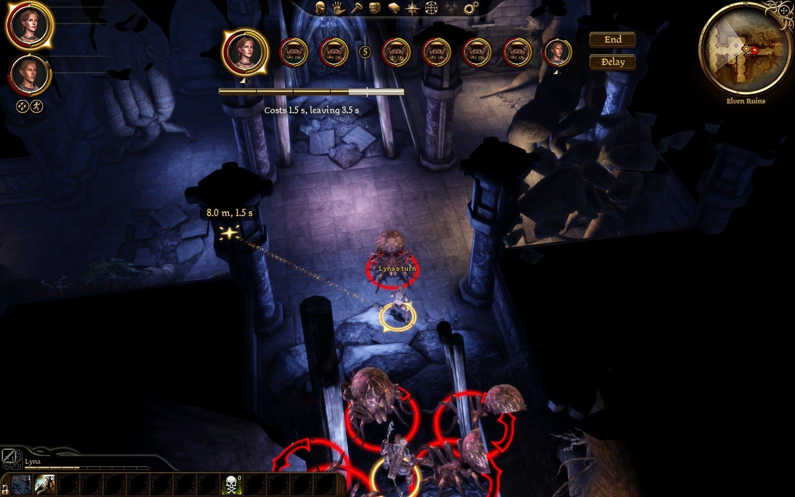
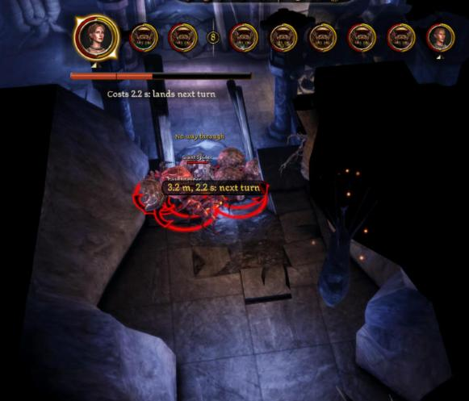
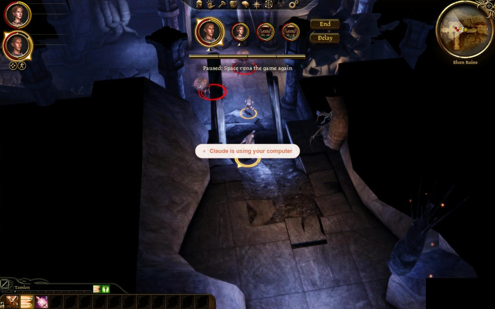
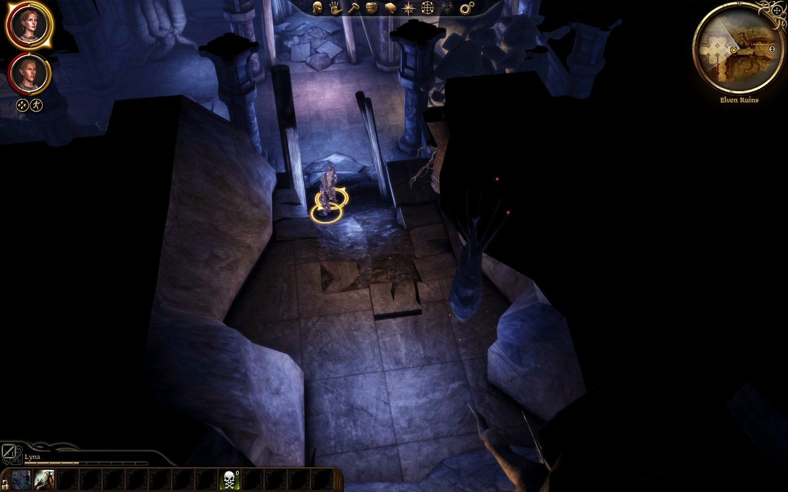
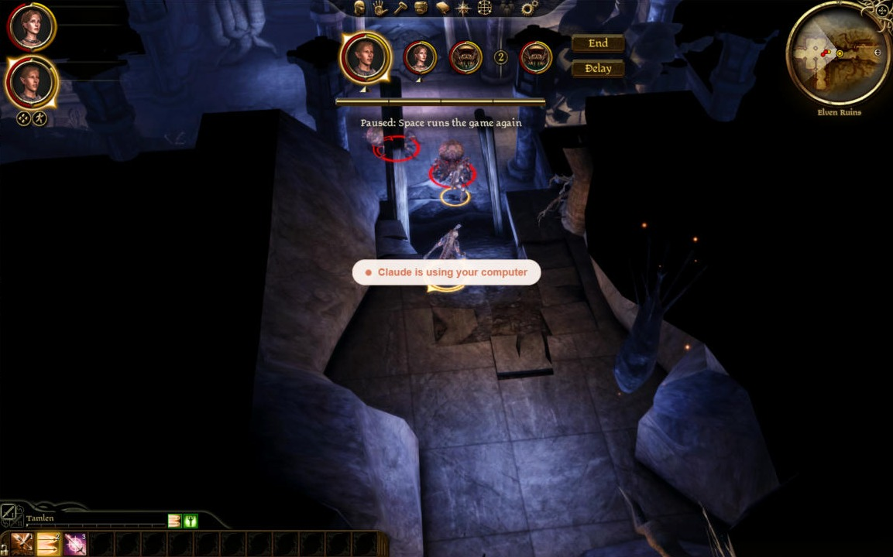
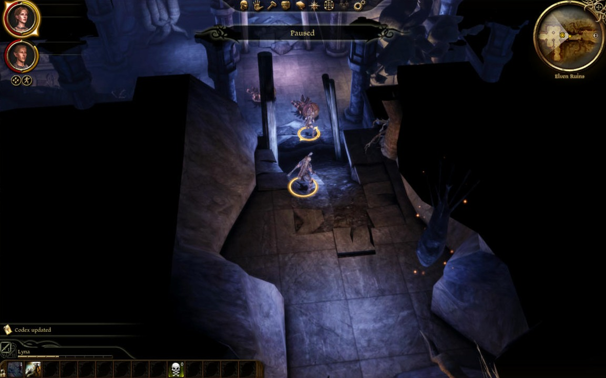

# Play test 32: own clocks, damage over time on the turn clock, the pause, 3x (2026-10-02)

By the tester's mouse and eyes, on the build of `02e4fa2`. Its notes, then what was made of them.

GOG game, `turnbased.dll` of 15:58:45 as deployed (commit 02e4fa2), `eluvian.dll` of 13:14:01. Lyna's `AutoSave_2`, loaded with no content dialog (no Force Load); nothing saved. The ini when I came: `clock = time`, `speed = 1.5` (not 1 as the request said, and not one of the slider's stops), `own_clocks = true`. I set 3x through the Options slider for a round, then `speed = 1` through `turnbased_settings`; it is left at **1**, not the 1.5 I found. Lyna on her Dar'Misu with Chain Lightning, Walking Bomb (12005) and Stealth (100075) added; Tamlen with Walking Bomb and Stealth. One fight: the hall's two spiders, six more spawned round Tamlen, ended by `stage kill`; then one spider spawned for the stealth try. No warning or error in the log, no crash. Log: `build\playtest-2026-10-02-32-turnbased.log`; the poison's timeline: `build\playtest-2026-10-02-32-dot.txt`; the 3x round: `build\playtest-2026-10-02-32-3x.txt`. Pictures: `dev\images\time-*-2026-10-02-32.jpg` (four).

## The tester: Worst first

1. **After the fight, a real-time pause shows no banner at all.** Space with no fight on: Eluvian's `health` says `paused: true`, and the screen shows nothing of the game's "Paused" (`time-real-time-paused-after-fight`, the game's own frame). The plugin's hiding of the banner seems to outlast the fight. A player who pauses in real time cannot see that the game is paused.
2. **The Options slider shows 1x for a speed of 1.5.** The ini held `speed = 1.5` (the user's, or a default from before the stops changed); the slider showed "1x". If the player presses OK without touching it, I expect 1.5 becomes 1; if not, the slider and the game disagree.
3. **The first poison tick of each turn can come as a lump of two.** Walking Bomb on spider `0x305` (cast by Tamlen at 16:18:57): on its first turn its health went 48.1 to 34.2 in one step 25 ms after the turn began (two ticks at once), then nothing more that turn. On its second turn three ticks a second apart (34.2, 27.3, 20.4, 13.5). On its third, one tick, then the turn ended and the last tick (6.5 to 0) came at once with the next turn's start. The floaties will show a double number for the lump.
4. **Stealth could not be staged.** Stealth ordered by `order ability 100075` was "given" but no stealth effect showed on Lyna, and a spider spawned 6 m off attacked Tamlen at once ("combat began: turn-based"). With every enemy of the ruins' first rooms dead by then I had no unseen enemy. Not judged.
5. **The spider dropping from the ceiling did not win the first turn**: Tamlen had initiative 14 against the spiders' 8, so his was the first turn; nothing to judge.

## The tester: By item

**1. Pause.** In the fight, on Tamlen's turn: the plate its usual see-through self, nothing black, no banner behind or between the cards, "Paused: Space runs the game again" under the bar (`time-paused-in-fight`). Space ran the game again. After the fight: finding 1.

**2. Damage over time on the turn clock.** Walking Bomb from Tamlen on a spider; Lyna sat 6 s on each of her turns without acting, Tamlen ended his at once (timeline in `-dot.txt`). Ticks came only on the poisoned spider's own turns: none during Lyna's idle turns, none during Tamlen's (but for the cast's own first hit, 55 to 48.1, and the last tick at the turn change). Two or three a turn, as said, and the rest at once when its turn ended. It killed the spider on the third round. The poison trap near the undead I did not reach.

**3. Each creature's own clock.** Walking Bomb's two effects on the spider read 20.0 and 20.8 s at the cast, 16.0 / 16.8 at the next round's first turn, 12.0 / 12.8 at the one after: 4 s a round, lost only on the spider's own turn (Lyna's six idle seconds took nothing).

**4. A blocked attack's word, and blocked spiders.** Lyna's right-click on a spider buried in the pack round Tamlen (6.5 m, 4.5 m of path quoted): she walked, and 3.8 s after the order "Lyna's attack failed (COMMAND_FAILED_INVALID_PATH): its action is given back", with **"No way through" in gold over her** (`time-no-way-through-gold`). Small (the size of the game's name labels) but clear. Blocked spiders: with eight in the fight, at 3x, spider turns of 0.2 to 2.6 s, eleven "NO_SPACE_IN_MELEE_RING: its action is given back" in a minute, several turns of 0.2 s: they now give up at once.

**5. Many cards.** With eight cards the bar starts under the first (current) card and the caption is under it (`time-bar-under-first-card`). "waits" and "X loses the turn" not seen this time.

**6. Fight speed.** The slider steps 1x, 2x, 3x, and stops at 3x; tooltip as before. 3x for about two rounds (from 16:21:46): a party member's three orders in about 2.5 s, a spider's turn 0.2 to 2.6 s, a round of eight spiders and two party members about 14 to 17 s. By the clock it is quick enough that nothing drags; whether the swings look like a sped-up film at 3x I cannot say from stills. Set back to 1x.

**7. The ceiling spider's first turn.** Finding 5.

**8. Stealth.** Finding 4.

## The tester: Not done

- The poison gas trap; stealth; the ceiling spider winning the first turn; "X loses the turn"; "No line of sight" and "Nothing happened"; 0.5x.

## What was made of it

| Found | Made of it |
|---|---|
| 1. After a fight, a pause in real time showed no banner at all | The banner was shown again only when the bar's movie asked for its view or said it had cleared, and after a fight it does neither. Now it is shown again on the first frame with no fight (`BarLink::FollowFight`). |
| 2. The slider showed "1x" for a speed of 1.5 | 1.5 was a stop before the stops changed; the slider shows the nearest. A file's value is left as it is until the slider is moved. |
| 3. A poisoned spider's first tick of a turn came as a lump of two | Its turn began by paying the rest of an attack it had kept from the turn before: that time passes on its clock at once, and the ticks in it come together. As the design has it. |
| 4. Stealth not staged | Tried with no hands the same afternoon (`timeplay.py --scenario stealth`): the blow lands and the turns begin after it (`dev/REBALANCE.md`, "Open"). The tester's order of Stealth came before the ability was given. |
| 5. The ceiling spider did not win the first turn | Its fix is covered by a scripted case; to see when the dice allow. |

What passed: the pause in a fight (the plate as ever, no banner, the caption); damage over time only on the poisoned creature's turns, two or three a turn, the rest at the turn's end, none while a party turn waits; effects' time 4 s a round, only on its owner's turns; "No way through" in gold; blocked spiders' turns 0.2 to 2.6 s; the bar under the first of eight cards; the stops 1x, 2x, 3x, and at 3x a round of ten in 14 to 17 s.

## The re-check of the pause (play test 32b)

On the build with the fix (16:28:53): in a fight no banner behind or between the cards, the plate see-through, "Paused: Space runs the game again"; the fight over, Space in real time shows the game's own "Paused" at the top centre, as the unmodded game does. Passes.

