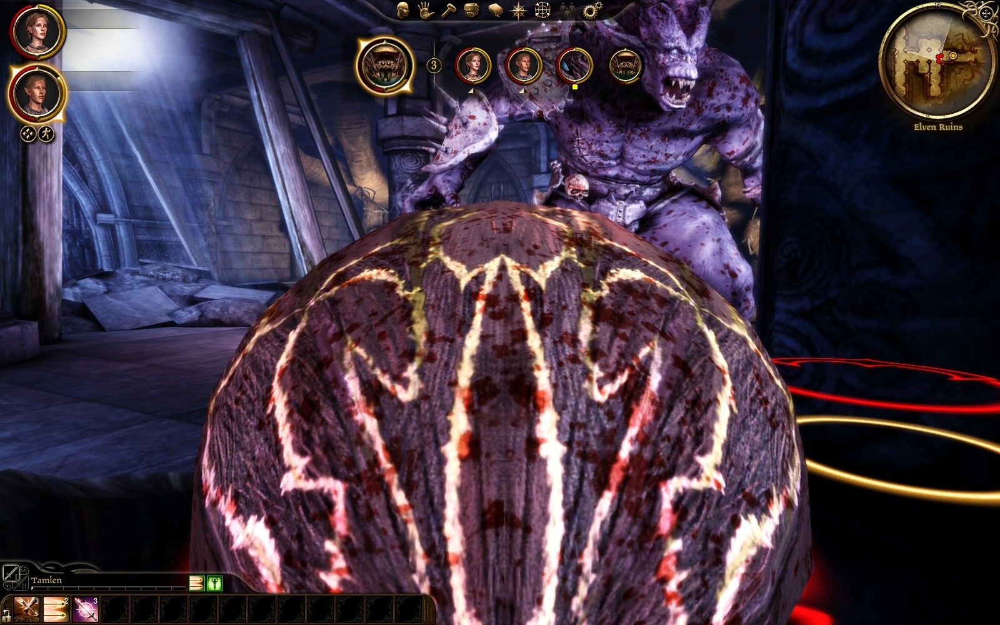
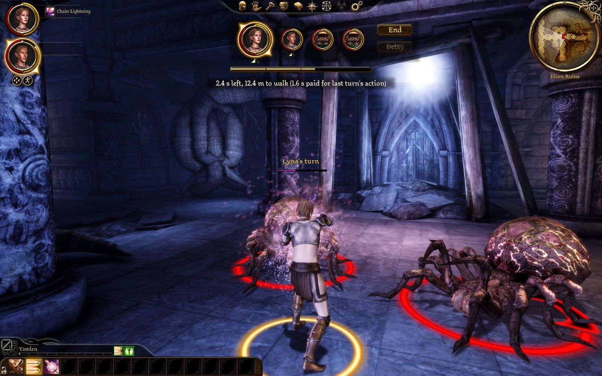
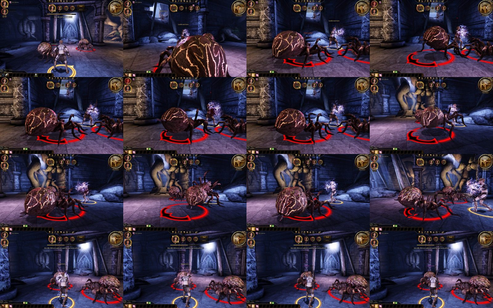
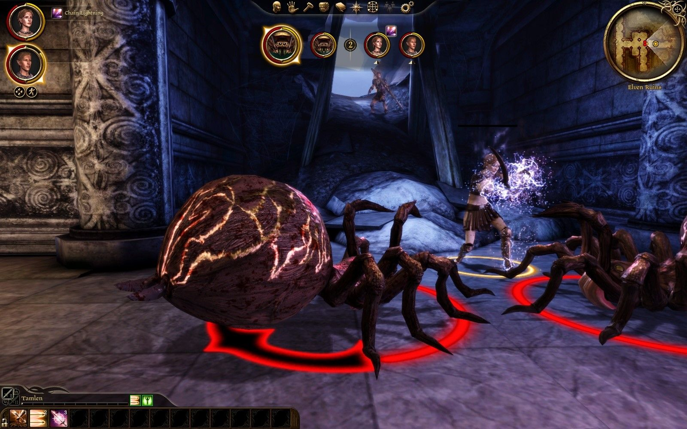
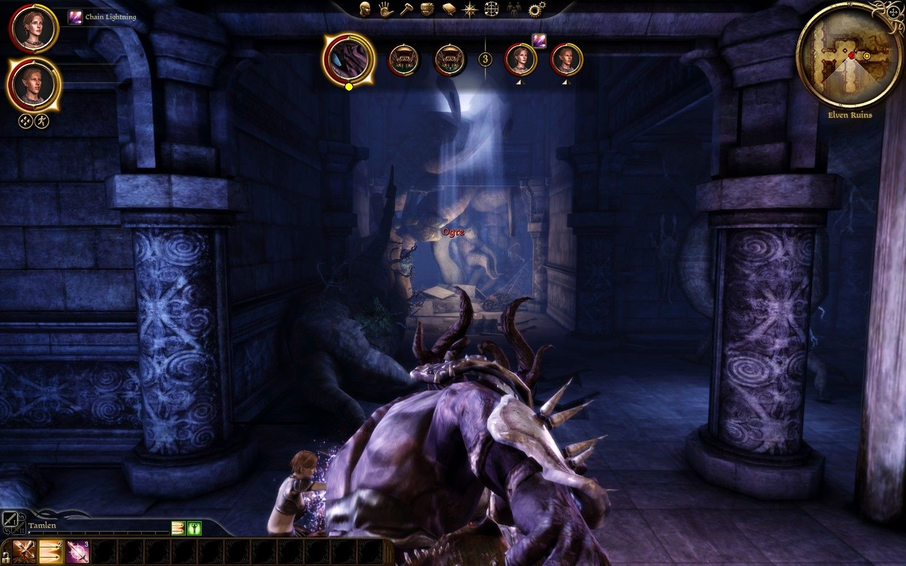
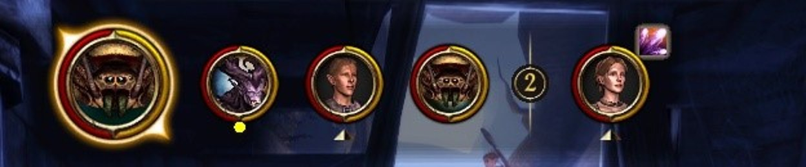
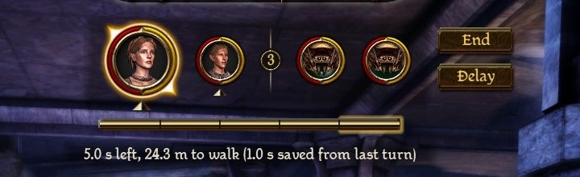

# Play test 33: the game's own conjuring across turns, grabs (2026-10-02)

By the tester's mouse and eyes, on the build of `d251aa6`. Its notes, then what was made of them.

GOG game, `turnbased.dll` of 17:55:47 as deployed (commit d251aa6, DAOLib 18fcbda), `eluvian.dll` of 13:14:01. Lyna's `AutoSave_2`, loaded with no content dialog (no Force Load); nothing saved; settings untouched (`clock = time`, `speed = 1`). Lyna on her Dar'Misu with Chain Lightning; one fight in the hall (two spiders, then an ogre spawned beside Lyna), played by Eluvian's orders with the game's frames kept every 0.4 s; the camera left at the game's own close third-person view this time. Ended by `stage kill`. Two warnings in the log (finding 1), no crash. Log: `build\playtest-2026-10-02-33-turnbased.log`; timelines `build\playtest-2026-10-02-33-conjure.txt` and `-ogre.txt`. Pictures: `dev\images\time-*-2026-10-02-33.jpg` (five).

## The tester: Worst first

1. **A spider's pinning attack stalls the fight 36 s and then holds a party member for ten turns.** Twice. At 18:00:20.133 a spider's "attack (action, from script)" became an execute effect on Lyna (the spiders' Overwhelm, by the look: the spider on top of her); the spider's turn ran until the mod's guard: "still at a execute effect after 36000 ms: stopped", "Giant Spider's turn ends: took too long". For those 36 s nothing else moved and the camera sat inside the spider's abdomen (`time-36s-spider-stall-camera`). Then: "Lyna's turn is lost: held by another's action (31.8 s more)", the spider's own turns "spent on its pending attack (28.25 s more)", and Lyna lost her turns in rounds 3, 4 and 5 ("27.8 s more", "23.8 s more") while the ogre beat her to 0. The same at 18:02:19 on Tamlen: "held by another's action (32.0 s more)", turns lost in rounds 8, 9, 10. At 4 s a turn a 30-odd-second hold is eight turns lost: a death sentence, not a pin. The game's own clock for that hold seems to run in real seconds while the mod pays it in turns.
2. **The bolt does not fly at once on her next turn.** Lyna, 3.43 s left after a step, Chain Lightning at a spider: "begins use ability (4.99 s): 1.56 s of it is over what is left", "its spell (ability 10211) conjures, held until its time is paid", "Lyna's turn ends: its spell conjuring". At her next turn: "1.56 s of it paid for its pending use ability: 2.44 s and 12.4 m left", "its held conjure let complete (0.01 of 3.87 s had run)". So the conjure did not advance while the others acted (0.01 of 3.87 s), and the whole 3.87 s of it played at the start of her turn: the spiders' health had not changed 3.5 s into her turn (my poll, 17:59:10.7 to 17:59:13.7), and the frames show the release animation still going 2 s in (`time-conjure-released-her-turn`). She paid 1.56 s on the bar and spent about 4 s of her turn standing; the bar said 2.4 s left all the while.
3. **The camera during the others' turns shows little of the conjuring.** It follows each actor from behind at the game's close view: during the ogre's turn the ogre's back filled the frame and Lyna's conjuring and "Spell lost" were behind it (`time-ogre-breaks-conjure-camera`); during the stall, the spider's body.

## The tester: By item

**1. Conjuring through the others' turns.** Visible: lightning crackling round her through both spiders' turns, frame after frame (`time-conjuring-during-spider-turn`; the whole run in `time-conjure-sheet`), her card carrying Chain Lightning's icon, the game's own action label "Chain Lightning" by her portrait. Her turn ended as she began conjuring (17:59:01.471). On her next turn the caption said "2.4 s left, 12.4 m to walk (1.6 s paid for last turn's action)". The bolt: finding 2. Both spiders were hit (55 to 17 and 26) by the time I looked again.

**2. The ogre breaks it.** Ogre spawned 3 m from her, Chain Lightning ordered with 2.27 s left (2.72 s over), her turn ended conjuring; the ogre's first act (an ability, 18:00:11.235) broke it at 18:00:13.193: "Lyna's conjuring was cleared before its time was paid", "pending use ability is dropped: interrupted while conjuring", "its held conjure ended COMMAND_FAILED_COMMAND_CLEARED: the spell is lost"; she was knocked down 1.4 s. Mana: 120 of 120 before the cast and 120 after it was lost (`manaStamina` from Eluvian's creature read): nothing taken. I did not see "Spell lost" on screen (finding 3); the log has the floaty effect on her at 18:00:13.202. No damage number with it, so no "Interrupted" expected.

**3. A grab.** I did not see a grab: the ogre used two abilities (one at 18:00:11, Ram at 18:00:59) and attacks. Lyna's knock-down cost her "1.4 s of its time" and was settled before her next turn; the turns she lost were to the spider's hold (finding 1), with no "loses the turn" seen on screen (the camera was elsewhere).

**4. Else.** Findings 2 and 3; the pending icon on her card and the portrait label were right throughout.

## The tester: Not done

- A grab by the ogre; "Spell lost" and "loses the turn" on screen; a zoomed-out camera through the others' turns.

## What was made of it

| Found | Made of it |
|---|---|
| 1. A spider's Overwhelm stalled the fight 36 s, then its victim lost turns for 31.8 s | With own clocks the steps of an action's own effect moved its creature's clock and its target's, and nothing else: what ends an Overwhelm is on neither, and it ran until its patience stopped it. The steps move the shared clock too now, as before own clocks, the round's worth that much the less; and an action stopped as too long leaves its target owing none of it. Seen with no hands (`timeplay.py --scenario overwhelm`): the spider's Overwhelm over in its own seconds, the spider's turn 13 s of the wall's clock, Lyna's next two turns lost and 1.05 s of the third, its 9.3 s. |
| 2. The bolt did not fly at once | The release fed the held conjure and let it go in the same frame, before the feed was set: the whole 3.87 s played in real time. Then held on, it was fed what was left, a total the conjure's elapsed time is set to, and stood 0.04 s short for ever. Now it is fed its whole length and held until its command ends. Seen with no hands: within 0.6 s of her turn the spider's health was down, 55 to 17, and the turn hers. |
| 3. The camera follows each actor from behind at the close view, hiding the caster and "Spell lost" | Not changed yet: a question of how the camera should sit through the others' turns, put to the user. |
| A grab not seen | The ogre used Ram and attacks; the grab is checked by the scripted cases and the random fights, and was seen in a run with no hands (an ogre's grab of about 4.8 s, the victim's next turn lost). |

## The ogre's portrait (the user, the same evening)

The user: "portrait for ogre looks off" (its card a close-up of its arm and chest). The game's portrait renderer aims at a creature's head bone from the portraits table's distance, a person's 0.675 m for any creature the table does not name; from an ogre's head that is inside it. With DAOLib `046dad9` and `7680eba` (`dao::portraits::SetCamera`) a creature bigger than a person is framed from further back, by its size in the appearance table (`core/Portraits.h`, `PortraitDistance`): an ogre from 2.47 m, its face, horns and teeth. A person-sized creature keeps the table's camera.

## The re-check (play test 33b), and what the user asked after

The tester, on the build of 18:44: the bolt lands 0.7 to 1.4 s into her turn; the ogre's blow breaks a held conjure, her mana 120 before and after, "Spell lost" in gold over her; the ogre's card shows its face. One oddity: her turn after a knockdown was offered and then taken two seconds later as she got up (the hold's share paid as the turn began, then her getting up taken for an effect that held her). Now a creature getting up from a hold the machine ended as its turn began keeps its turn (`TurnMachine::GettingUp`). The random fights found with it that a creature whose action was kept could still turn a mode on in the same frame, which ran on into the next turn: with its action pending, its turn is over.

The user, looking at the bar the same evening:
- "ogre portrait isn't quite centered": the camera's offsets move with a creature's size as its distance does (`FrameBySize`): an ogre's face centred.
- "why's there a white vertical bar at 4s of the action bar", then: "we already have segments that show where 4s is. if we want to show clearly it's bonus, we can make the bonus part glow gold edge or something": the white mark is gone, and the bar's seconds past a turn's own glow gold about their edge.
- On the camera in the others' turns: "shouldn't camera pull back depend on creature size? for ogre or dragon pull back more, for human sized enemies same as player": with the camera following (`camera_follow`), a creature bigger than a person pulls it back by its size (`FollowZoom`, DAOLib `752c52d`'s `EaseZoom`), never into the tactical view (it flipped there at 0.73 and stayed); the party's turns have the player's own zoom back, unless the player zoomed meanwhile. A giant spider's turn 0.90, an ogre's 0.80, the party's 1.00, seen with no hands.
- "let's not include the end / replay buttons in the black background. doing so causes the background to change. background only covers the portraits.": the plate covers the medallions alone.

