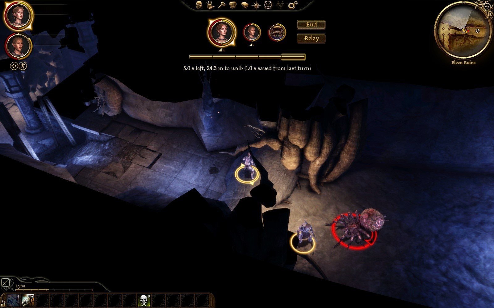
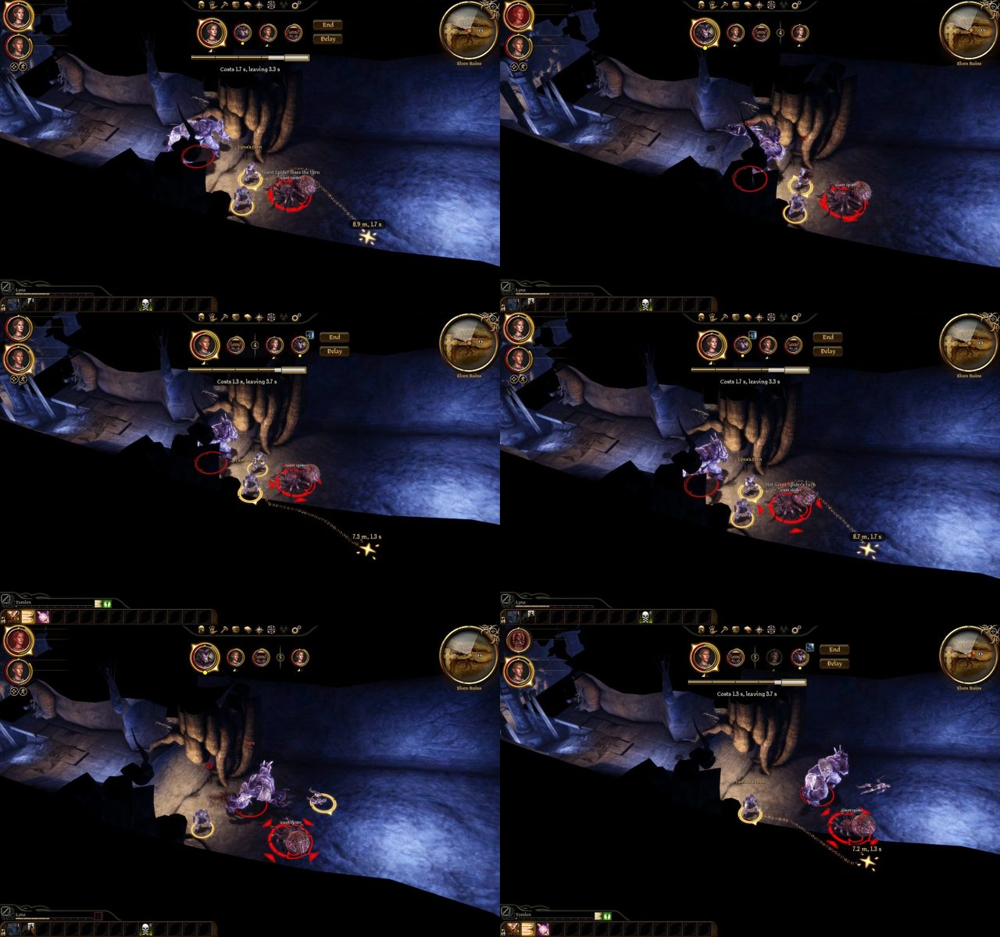
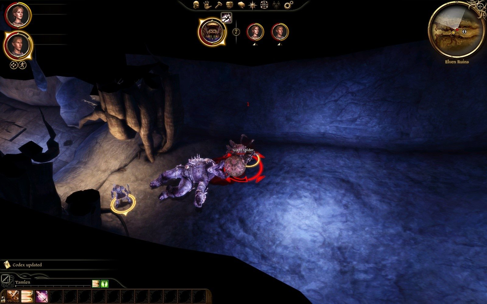
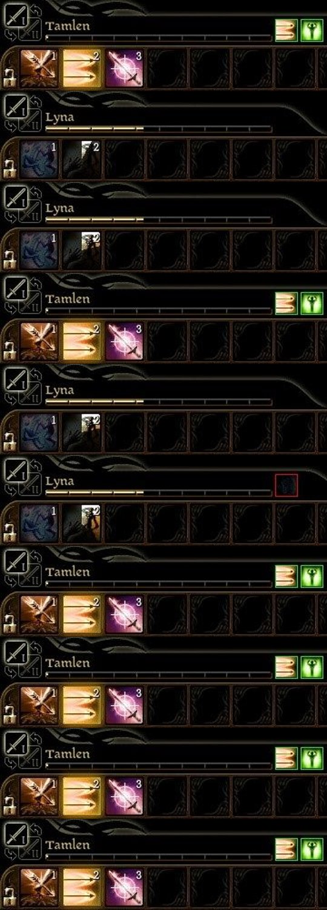

# Play test 34: object costs, shots read, the camera by size, the bonus second (2026-10-02)

By the tester's mouse and eyes, on the build of 20:00. Its notes, then what was made of them.

GOG game, `turnbased.dll` of 20:00:59 as deployed (DAOLib 752c52d), `eluvian.dll` of 13:14:01. Lyna's `AutoSave_2`, no content dialog (no Force Load), nothing saved, settings untouched (`clock = time`, `speed = 1`, `own_clocks = true`, `camera_follow = true`, `object = 0.5`). One fight by the cocoon `0x1f6` in the first hall: one spawned spider, then an ogre, then the spider alone again; party turns mostly ended by Eluvian, the shots and the talent by mouse. No warning or error, no crash. Log: `build\playtest-2026-10-02-34-turnbased.log`; timelines `-34-turns.txt`, `-34-overwhelm.txt`. Pictures: `dev\images\time-*-2026-10-02-34.jpg` (four).

## The tester: Worst first

1. **Overwhelm no longer stalls the fight, but the victim still loses four turns.** Ordered as the spider's own at the start of its turn (20:09:15.172): it walked, "is at its use ability" at 17.222, its turn ended at 27.097 (12 s on the wall: a 2 s bar plus the hold playing out, no guard, no 36 s). Then Lyna's turns were lost in rounds 7, 8, 9 and 10 ("held by another's action (15.2 s more)", 11.2, 7.2, 3.2) while the spider's own turns were "spent on its pending use ability"; her first turn back was round 11. With the party ending its turns at once those four rounds passed in 9 s of wall time, so on screen it is quick, but four turns is not "about two": the hold still counts 15 s after its turn, 4 s a turn. ("loses the turn" in gold I did not catch: the camera was on the spider, picture `time-overwhelm-hold`.)
2. **Opening the cocoon cost 0.5 s, then the turn stood "executing" while its loot window was open.** 5.0 s became 4.5 s at once ("use object costs 0.50 s; 4.50 s and 22.0 m left"), but the game opened the cocoon's inventory, and the mod's phase stayed "executing" for as long as it was open (16 s of my polling) with the cards and End drawn over the dimmed window. After "Take All" it returned to "4.5 s left, 21.5 m to walk" and her turn went on. Fine by the rules; worth knowing that a loot window is part of the action. The less-than-0.5 s case not tried.
3. **The quickbar is the selected character's, and the selection follows the turn**, so Lyna's Dirty Fighting cooldown shows only on her turns: at her talent (20:06), dark slot with the full sweep; in her later turns (r3, r4) the slot's dark part was a little smaller each time, and on the others' turns the bar was Tamlen's or Lyna's depending on who was selected (`time-quickbar-strip`). It looked right as far as stills can show; I cannot tell from 1.5 s stills whether it moved during the ogre's turn.

## The tester: By item

**1. Objects.** Finding 2.

**2. Bow shots.** Tamlen at 7.5 m: first shot quoted "Costs 1.4 s" (the flat figure); log "its shot took 1.83 s of the game's time (the flat figure 1.40 s): what its next costs"; the next caption "Costs 1.8 s, leaving 0.8 s"; second shot measured 1.61 s; the third caption "Costs 1.7 s: lands next turn" (the average of 1.83 and 1.61). On screen a shot from draw to the arrow's arrival looked like the 1.6 to 1.8 s quoted. No Haste or Aim tried.

**3. Camera.** With camera_follow on the camera moved to each actor in 0.6 to 0.9 s ("camera on 0x... after 774 ms"), tactical, and came back to Tamlen and Lyna at the zoom I had. During the ogre's turn the frame showed the ogre, Lyna and Tamlen together (`time-camera-turns-sheet`, top right and bottom left): what it did to whom was visible, unlike play test 33's close view. I did not see an extra pull-back for the ogre against the spider in the stills; the view was already zoomed out. The wheel during an enemy turn not tried.

**4. The cooldown sweep.** Finding 3.

**5. Overwhelm.** Finding 1. Also: the ogre's Grab on Lyna (20:07:35 to 45, "its icon is 'eff_ico_ogre_grab'") ran 10 s inside the ogre's turn, and she fell at 20:07:45.5 before the turn ended; I did not see her next bar.

**6. The bonus second.** After ending Lyna's first turn at once her next bar was "5.0 s left, 24.3 m to walk (1.0 s saved from last turn)", the last tick of the bar edged brighter in gold (`time-bonus-second-gold-edge`). The plate behind the cards stops at the last portrait, End and Delay outside it.

## The tester: Not done

- Using an object with under 0.5 s left; Haste or Aim on Tamlen; the wheel during an enemy turn; "loses the turn" on screen.

## What was made of it

| Found | Made of it |
|---|---|
| 1. The victim of a spider's Overwhelm lost four turns, not about two | The Overwhelm held Lyna 9.3 s, its own length (her clock moved 9,297 ms by its steps); the other 9.9 s she owed were left from an ogre's grab of ten seconds that she had fallen in. A fallen creature's turns are passed over, so the debt outlived her fall. A creature that falls now owes nothing of what held it before. |
| 2. The cocoon's loot window stood open with the turn "executing" | The game's own window, part of using the object: the 0.5 s was taken as it began and the turn went on after. Nothing to change. |
| 3. The cooldown sweep is seen only on its owner's turns | The quickbar follows the selected character, as the game's does: a slot's sweep moves on its owner's turns, which is all there is to see. |
| What passed | Object costs (0.5 s, the turn going on), the measured shots (the caption 1.4 s for the first, then 1.8 s and 1.7 s as Tamlen's shots took 1.83 and 1.61 s), the camera reaching each actor and the party's turns back at the player's zoom (the ogre, Lyna and Tamlen in one frame on the ogre's turn), the bonus second's gold edge, the plate stopping at the last portrait. |
