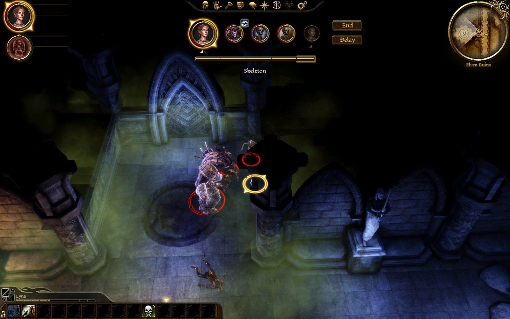
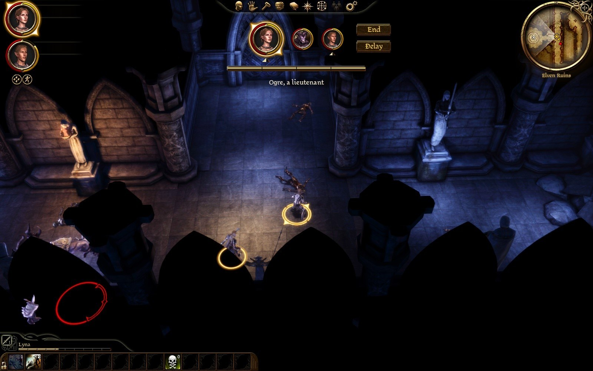

# Play test 35: the ruins' gas by its plate, the bar's centring, no rank dot (2026-10-02)

By the tester's mouse and eyes, on the build of 21:41 (16b8bd2, DAOLib 10ac778). Its notes, then what was made of them.

GOG game, `turnbased.dll` of 21:41:50 as deployed (16b8bd2, DAOLib 10ac778), `eluvian.dll` of 13:14:01. Lyna's `AutoSave_2`, no content dialog (no Force Load), nothing saved; `turnbased.ini` untouched and still `clock = time`, `speed = 1`. Staged as the gastrap scenario: the four talk triggers off (`SetObjectActive 0` on `0x38a`, `0x385`, `0x389`, `0x387`), Lyna to (-66, 1.5, 0), Tamlen to (-63.5, -1, 0), `ogre_default` at (-55, 0, 0); the fight began at once and two skeletons of the room joined it. Lyna walked onto the plate on her first turn. Her turns were left waiting 3 s and then ended by Eluvian (she never acted); Tamlen fell early; Lyna was set back to full three times. Ended by `stage kill`. No warning or error, no crash. Log: `build\playtest-2026-10-02-35-turnbased.log`; her health turn by turn: `build\playtest-2026-10-02-35-gas.txt`. Pictures: `dev\images\time-*-2026-10-02-35.jpg` (two).

## The tester: By item

**1. Bar centring.** Five cards (Lyna, the ogre, two skeletons, Tamlen): the cards span about x 595 to 1005 of the 1600 px game frame, the bar 612 to 990, the caption's centre at 800. Centred under the portraits (`time-bar-centred-five-cards-in-gas`). With three cards (`time-ogre-lieutenant-no-dot`) also centred.

**2. No rank dot.** No dot under the ogre's card, nor under any other; hovering the ogre's card gives "Ogre, a lieutenant" in the caption (`time-ogre-lieutenant-no-dot`).

**3. The gas.**
- **Never while a turn waits.** Lyna's health never changed while her turn stood "awaiting order" (seven turns, 3 s each): every change of her health fell in an executing phase or at a turn's start.
- **The number at her turn's end.** Seven times her health dropped 0.13 to 0.17 s after "Lyna's turn ends" and before the next creature's turn began (e.g. turn ended 22:15:09.387, health 93.3 to 81.8 at 09.548, the ogre's turn at 09.722; 28.975 / 29.163 / 29.305). The ticks were 11.5, 11.4, 18.2, 18.2, 11.4, 18.1, 6.7. The beat between her turn's end and the next turn is about 0.33 s on the log's clock; I saw it only in stills, and in the one series I took at her turn's end (round 8) no number appeared (see below), so I cannot say whether the camera was still on her when the number popped. The green cloud fills the frame around the plate the whole time (`time-bar-centred-five-cards-in-gas`).
- **How long.** Poisoned from her walk onto the plate in round 1 to her turn in round 8: ticks at the ends of rounds 1 to 7, the effect (`EFFECT_TYPE_DOT` from "Pressure Plate", duration 30.75 s) read 3.3 s left at the start of round 8, and at that turn's end its last 3.3 s went at once with no visible tick and no health change. About 8 rounds, as wanted.
- Two health changes inside her own turn in round 1 (22:15:05.396, 100 to 93.3, while she walked onto the plate) and round 7 (22:16:52.667, 83.9 to 78.1, at the turn's start while her knock-down was settled): the first is the gas reaching her as she stepped in, the second I cannot attribute.

**4. A fight through.** Nothing stalled. The ogre's Ram knocked Lyna down in round 6 (2.2 s held), and round 7 began "condition takes 2.17 s ... was held 1.25 s by another's action": her bar was 0.72 s of 5.0. Round 9: "Lyna's turn ends: held by an effect". Turn lengths were ordinary (the skeletons 2 to 6 s, the ogre 3 to 12 s with its abilities). The fight is very hard for two level-1 characters: the ogre and the skeletons put Lyna at 5 to 30 health three times in eight rounds with the gas.

## The tester: Not done

- The camera at the moment of the beat, by eye; a fight with Lyna acting in the gas.

## What was made of it

| Found | Made of it |
|---|---|
| 1, 2. The bar and its caption centred; no rank dot, the rank said under the pointer | As built that evening: passed. |
| 3. The gas never struck while a turn waited; a tick in the beat after each of her turns; about eight rounds | As built: passed. The beat measured 0.33 s on the log's clock (300 ms of the real clock, `kLandMs`). |
| 3. A drop inside her own turn in round 7, at its start, unattributed | The knock-down's time: "condition takes 2.17 s" of her turn's clock as the turn began, her own clock run by that much at once, and a tick that fell due in it landed then. In her own turn and not while it waited on an order: as designed. The one in round 1 is her walk onto the plate, which runs her clock as she goes. |
| 4. Very hard for two level-1 characters | The party never acted (the test's setting), against an ogre lieutenant and two skeletons in a 30 s cloud; not a measure of balance. The fights' length and cost are measured apart (`timeplay.py --scenario duel`). |
