# The turn-based UI: made of the game's own

The turn order bar, the movement preview and the on/off switch should look like Dragon Age, not like an overlay. So they are built from the game's own UI: its Scaleform movies, its art, and its live portraits. No ImGui, no overlay drawn over the frame. This page is what exists in the game to build them from, the data the mod already has for them, and what DAOLib must reach first (`dev/DAOLIB_NEEDS.md`, "The UI").

Until then the mod speaks through the game's floating text (`DisplayFloatyMessage`): "Alistair's turn", "Out of movement", "Not Morrigan's turn".

## What the game has

Read 2026-09-30 from the install's `packages\core\data\` (the ERF archives as `tools\gda.py` in DAOLib reads them).

- **The UI is Scaleform GFx**, Flash movies: 67 `.gfx` in `guiexport.erf`. Among them `portraits.gfx` (the party bar), `partypicker.gfx`, `quickbar.gfx`, `tactics.gfx`, `optionsmenu.gfx`, `floatylayer.gfx` (floating text), `tooltips.gfx`. They are compressed SWF version 8 (`CFX`): ActionScript 2, editable with JPEXS Free Flash Decompiler.
- **The art** is in texture atlases, `atl_shared_dxt1_00.dds` to `atl_shared_dxt5_02.dds`, which the movies share, and swatches in `gui.erf` (`red`, `green`, `blue`, `yellow` at three strengths, `white`, `transparent`). The fonts are `gui.erf`'s `nogard.ttf` and `nogard_text.ttf`, and each language's `fonts_*.gfx`.
- **Portraits are rendered live**, not stored. The data table `portraits` (DAOLib's `dev/gda_tables.csv`) has per creature tag a camera pitch, rotation, distance and offsets, a light and a tint, with a `Default` row for everyone else; the party bar asks for them through `GetPortraitByCharacterID` in `portraits.gfx`. So any creature can have a portrait (enemies too, as in BG3), framed by the camera the game would use.
- **Rank frames.** The table `creatureranks` has a `PortraitFrame` per rank and a colour: yellow for a lieutenant, orange for a boss or elite boss (`0xFFFF00`, `0xFF6600`). The bar can mark bosses the way the game's own target display does.
- **How movies talk to the engine**: `FSCommand:`s, the names in the movies' strings (`GetObjectNameByID`, `Get2DAValue`, `GetM2DAValue`, `GetTlkString`, `SendMessage`, `LoadMovie`, `SetValue`, `PlayGUISound`, `SetTimeScale`, ...), and a data tree the engine publishes and the movies bind to (`GUI.SelectedChar.Attributes.7.Current`, the selected character's health; `CORESTATS_HEALTHCURRENT`).
- **A ring that follows the cursor** already exists: area-of-effect spells show one while being aimed (explore mode's `ActivateAnalogTargetModeMessage`).

## The turn order bar

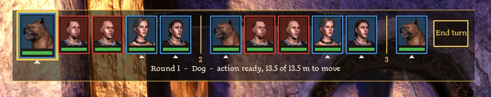

In the game, above: the Dog's turn, the Howe Archer and Howe Soldier with portraits the engine rendered for them, the party's from the game, round 2 and 3 after the dividers. It shows over the fight in the game's fonts, placed top centre, with the party bar and minimap still in view.

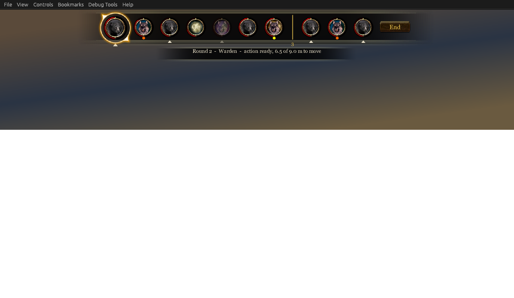

The prototype above, drawing its sample fight in a Flash player: round 2, the Warden's turn (larger, gold frame, the ▲ of a character the player commands), a Hurlock Emissary with a boss's orange inner border, a Genlock Alpha with a lieutenant's yellow, Morrigan fallen and greyed, a soldier fighting beside the party in green, the divider into round 3, and End turn. In the game every card should carry its combatant's portrait (below); outside it they carry initials.

- Top centre, as BG3's. The current turn first, larger and lit; then the rest of this round; a divider with the next round's number; the next round. Ten cards at a time (`TurnView::kShown`; twelve until issue 14), and with more fighting than that an arrow at each end of the row moves it along the turns to come (below, "More fighting than the row holds").
- A frame per side: blue for the party, red for enemies, green for allies. It takes the rank's frame and colour from `creatureranks` for lieutenants and bosses. Health is a thin bar under each portrait.
- A fallen party member stays, greyed; fallen enemies go.
- The party members the player commands have a ▲ under them, as BG3 marks them.
- Hovering a portrait shows its name, health, and mana or stamina (the game's tooltip movie); clicking centres the camera on it.
- An end-turn button (BG3's hourglass) at the right end, the same as the pause key.
- Under the current portrait on the player's turn: the action left (a pip) and the movement left (a bar, meters).

All of that is `tb::TurnView` (`src/core/TurnMachine.h`): per card the id, name, tag (for the portrait's camera), side, rank, health, fallen, current, whether the player commands it, and round; and the current turn's actions and movement left. `TurnMachine::View()` makes one on the scripts' thread. The portraits come from the game's side (`tb::PortraitBook`, below).

### The movie, built 2026-09-30

`turnorder.swf`, from `ui/turnorder/frame_1/DoAction.as` (ActionScript 2), by `python tools\movie.py`. No Flash editor is involved:

- The tool writes a SWF 8 shell, the game's own version. It holds a 1280 × 720 stage, the game's two fonts imported by name from its font library (`$TitleFont` and `$BodyFont` from `gfxfontlib.swf`, byte for byte as `portraits.gfx` imports them; `tools/test_movie.py` checks), and an empty frame script.
- JPEXS FFDec compiles the ActionScript into that script from the command line, then decompiles the result to prove the script is there. FFDec 26.3.0 and Ruffle were installed in `C:\Modding` for this, 2026-09-30.
- The movie draws everything with ActionScript's drawing API (cards, frames, health bars, the plate behind them), so it has no symbols to draw by hand.
- A plain SWF is what the game looks for first, and GFx 3 loads one; `tools/deploy.ps1` puts it in the override folder (until 2026-10-05; beside the plugin since, "Where the file lives" below).

It asks `TB_GetView` three times a second. It builds the bar again only when the cards change; otherwise it sets the status line in place. A walk changes the meters left several times a second, and a rebuild would load every portrait again. The build fails unless every function and every `TB_` call of the source comes back out of the compiled movie. Outside the game (no `ExternalInterface`, or the parameter `sample=1`) it draws a sample fight, and `.\tools\snapshot.ps1` shows that in Ruffle, an open-source Flash player, and saves a PNG: the picture above. The preview uses a system font; the game's fonts need the game's font library. A stand-in, empty `gfxfontlib.swf` is written beside the build for the preview, since a player holds the first frame until an import resolves.

**Portraits.** The party's come from the game, the way its party bar gets them. Reading `portraits.gfx`'s scripts (FFDec, 2026-09-30) showed how. The party bar takes its members from the data tree, `Party.Members.0` to `3` and `Party.Summons.0` to `3`, each with an `ID` and a `Portrait`, an image's name, through the game's `ExternalInterface` calls `GetValue` and `AddTokenObserver`. It loads the picture with `loadMovie("img://<name>?Width=..&Height=..")`, which the game's image loader draws. The turn bar does the same for a party card, matching the member by id: no DAOLib work.

Enemies have no such entry. The game's creatures are a closed set, so they can have portraits too, three ways:

1. **Rendered live by the engine**, as the party's are: the portraits table's `Default` camera frames any creature. **Built**, on DAOLib `ce27567`. `CCCreature::RenderPortrait()` calls the engine's own `CCCreature::UpdatePortrait`, what the party bar, the paperdoll and character creation call. That makes the creature a portrait renderer the first time (a clone of its model, a 146 × 146 target, the portrait light rig) and returns the texture's `img://portrait_<n>` name. `PortraitImage()` gives the name without rendering. It is the least work, looks like the party's, and covers every creature, mods and DLC included.
2. **Rendered once in the game and shipped as images.** A capture pass spawns each creature template, renders it through the same renderer, and saves it with `D3DXSaveTextureToFileW`, which the game imports already. The same DAOLib work, plus the capture. Only worth it if live rendering is slow or fails for some.
3. **Rendered offline** from the game's models in Blender. The most work (DAO's mesh and morph formats, matching the portrait lighting), and the least like the game's own. A last resort.

How the plugin uses the first (`src/core/Portraits.h`, `src/game/Bar.cpp`):

- **One portrait with each view it publishes** (ten a second), in the order of the cards, so the current turn's and the next come first.
- **The engine's existing portrait first.** A creature that already has one, as the party does, gives it by `PortraitImage()`. Anyone else is rendered.
- **Each combatant once a fight.** An empty answer is remembered too, so a creature the engine makes no portrait for is not asked again. One whose model has no head node when its card first comes is asked again with the next views for a second, since a creature just come into the fight may not be set up yet; the cards after it wait meanwhile.
- **Nothing rendered while the fight stands aside** (a conversation, a menu). Everything is forgotten when the fight ends, since object ids are reused once an area is left.
- **The URL travels in the card's eleventh field** (below). The movie loads it as it loads the party's, and falls back to the party tokens, then initials.
- **A creature with no face** (a wolf, a bear, a spider, the swarm, a golem): the engine renders no portrait for it, and the game's portraits table (`portraits.gda`, table 7) names a ready-made picture by appearance instead (`Override`: `portrait_49` a wolf, ten textures in `gui.erf`), as the party bar shows a ranger's summons. A wolf's card showed its initials before (the user, 2026-10-01). And the engine's render is a person's framing unless the table has a camera for the creature: a giant spider, with no row, came out as a close view of its abdomen (the user's picture, the same night). So a card's picture is, in order (core's `ChoosePortrait`): the ready-made picture of its appearance; a render by the table's own camera, for a creature the table has a row for (a great bear, a blight wolf, the followers by tag); a render, for a person; the ready-made picture of its kin, a row of the same family by the label up to its first comma (a giant spider gets the spider's); else a render all the same, framed by the kind of body it is and its size (below). That last was initials until 2026-10-04 (an enemy mabari, a demon, a dragonling).
- **A picture for every card** (issue 32; built 2026-10-04; the tool and the dragons' framings seen in play that day, the rest not yet). The user, twice: "Dragon's portrait is clearly off", and of frames with a dragonling: "Looks like the portrait for dragon is not working in those screenshots". Two things were wrong. Twelve dragonlings of twelve had initials: the table has no picture of a dragonling or its kin and no camera for it, and the rule then gave none. And the high dragon's card was a blank disc: the rule framed a creature bigger than a person by a sum over the appearance table's personal space, which put the camera past what the engine draws. Every creature with no ready-made picture is rendered now; initials are left for what cannot be, which the log says: no creature by the id, or a model with no head node for the camera to aim at.
- **The engine's portrait camera**, read 2026-10-04 in the game's exe with DAOLib's `tools/daoexe.py` (`PortraitRenderer::PlaceCamera`, the address library's ID 21341). It stands back from the model's head node by three times the table's `CameraDistance` (the distance times 30 over 10, the 10 being the field of view it sets, in degrees), turned about the head by the pitch. The Z and X adjusts then move the camera along its own up and right, in metres, and its aim with it: an adjust is so many metres of the picture whatever the distance. With 10 degrees of view the picture is 0.525 of the distance across where the head is, which for the game's Default row is a face. And it draws from 0.15 m to 40 m: that was the blank disc, the dragon's camera standing 41.6 m from its head (seen in play the same day: from 36 m it is drawn).
- **What play showed that the reading did not** (2026-10-04, the tool below on real creatures at the camp and on the mountain top; the pictures are the game's own frames):
    - *The node the engine aims at is not always where the head is seen.* Straight on, a dragonling's and a drake's heads are well above it (with no raise the picture was the neck from the front, the head cut off at the top), and the high dragon's is at it.
    - *The rotation turns the view round the creature, and the head slides sideways as it does.* The high dragon at 25 degrees is seen three-quarter on, a wing behind its head, and with nothing aside its head is at the picture's lower left: what the engine turns about is not where the head is seen. An aside the other way brings it back, which is what the game's `Default` row does for a person, with its rotation and its offsets. It is also why a person's rotation and offsets given to another body lose it: the high dragon by them was a small figure at the picture's left edge.
    - *How far it slides is each model's own.* For the same turn the aside that brought the head back was a third of the creature's extent for the dragonling and the drake (one body at two sizes) and a sixth for the high dragon, where the whole picture is a third of the extent across. And it is not to be had from what the engine measures of the creature (how far its head node is from where it stands). Nor is it to one side for every model: of the rows the sweep found the same day, the archdemon's aside is the dragons' way, a dog's, a bronto's, a golem's and a demon's the other, and a cat's and a rage demon's heads stay in the middle with none.
    - *The measure is a pose's.* The same dragon read less than half as much from feet to head asleep on its ledge as in the air.
- **A side profile is what is wanted.** The user, of the straight-on pictures, 2026-10-04: "Can we not capture a bit of a side profile for creatures as we do for humans?", "Like maybe a 30 to 45° angle"; and of the dragons turned: "the angles look good."
- **The framing table: `src/core/PortraitTable.h`.** The user, the same day: "if we can put the portrait angles and stuff in a table somewhere by creature type, we'd have it all in one place." So it is one table in one file, a row a creature type, and every number of a portrait's framing is there and nowhere else (this page does not repeat them):
    - *a row* is an appearance (the appearance table's row and its label, `64 Dragonling`), then the game's own portraits table's columns, distance, rotation, pitch, aside and up (and the light where a row needs its own), and a note of where the row came from: who saw it, where and when, and what of it was seen as it is and what lies between two that were. A row is a camera somebody looked at;
    - *a kind's default* is a row of the same table for any body of that kind with no row of its own: one for a body on all fours, one for an upright body that is not a person's. Its distance, aside and up are per metre of the creature's extent, and the camera it gives is held between the table's least and most (the most is inside what the engine draws). The defaults are straight on, and the table's head says why: a turn needs its aside, the aside is each model's own, and guessed half wrong it puts the head out of the picture; straight on, what the engine aims at is in the middle whatever the model. They are for what nobody has looked at yet, and the side profile comes row by row;
    - *a row from the root* (`FromRoot`) is for a model with no head node, which the engine's camera has nothing to aim at: a deepstalker (the user, 2026-10-04, of its initials: "We should try to capture the lamprey like head"), a halla, a pig. The engine then aims at the origin of the portrait's scene, the clone's root (`dev/DAOLIB_NEEDS.md` has the reading), so such a row's camera carries the whole framing from there: its up is the height of what is wanted above the root. Only a row marked so renders a creature with no head node (core's `RendersWithoutHead`), or values a tester gives to find one; with neither its card keeps its initials, and a row that is about a head waits for the head, since a creature just made has none for some frames;
    - *a person's body* has, as a rule, no row: the game's own `Default` row frames it, with no camera given at all, so people, darkspawn and the walking dead are framed as they have been since 2026-09-30. Where that row does not do, the appearance has a row like any other, and its own row comes first: the hurlock alpha and the werewolf at a person's pitch and rotation from further back (its horns, its muzzle, were cut off), and the steel golem and the shriek, which the kind's rule takes for persons' bodies and the `Default` row missed the heads of, turned as the creatures are.
- **How a creature is looked up** (core's `FramePortrait`, the one place a framing is chosen; the code has no number of its own): its appearance's own row; else the game's own row for it, where the portraits table frames the creature itself (by its tag or its appearance: a great bear, a blight wolf, the followers), untouched; else its kind's default, which for a person's body is the game's `Default` row. The log and the tool say which it was: `row 66 Dragon, High (...)`, `the default for a body on all fours (...)`, `the portraits table's own row for it`, `a person's body: the portraits table's Default row`.
- **The kind of a body** (core's `BodyKindOf`, the one place that says; the user, 2026-10-04: "If different cases need to be handled differently, we can do that, w/ overloaded functions or something") is by what the game's data and the engine say of the creature, not by its name: *on all fours* if its body pitches with the ground it stands on (the appearance table's `TerrainFollowPitch` over 0, which the table has for everything on four legs or more and nothing that stands up); *a person's* if its model is put together as a person's is (`ModelType` `H` or `P`), it stands up, and it is no bigger than a person from its feet to its head; *upright* otherwise (the ogre and the high dragon are `H` models that stand up; a demon is no person's model).
- **A creature's size is the engine's**, not a table's: from its feet (its position) to its head node (DAOLib's `dao::portraits::HeadPosition`; `MeasureBody` in `src/game/Camera.cpp`, core's `ExtentOf`). The turn camera's distance went by the same measure until 2026-10-05; it goes by the model's box now, and by this only for a model that gives none (`dev/DESIGN.md`, "The camera going to whoever acts").
- **Filling the table.** Which creature types want a row is found by looking at every appearance (the user: "we can enumerate all the creatures in the game, test portraits, see which ones need special handling beyond the standard humanoid"). `python tools\portraits.py` stands a real creature of each appearance beside the party, renders it and keeps the picture (contact sheets of thirty in `build\portraits`); with `--row` it tries a camera for one, with `--search` a grid of asides and ups round it on one sheet, and each prints its line for the table, as `--print-row` does from numbers alone: filling the table is copying a line (`dev/TESTING.md`, "Through Eluvian"). A real creature of each, since one creature given each appearance in turn (`SetAppearanceType`) is not to be trusted: most rows did not take, and many that did came out empty or as a close-up of skin. **Where it stands, 2026-10-04**: the sweep was run at the camp and the table filled from it by eye, so that every appearance of the campaign that renders and is not framed well by the game's own has a row, turned for a side profile; `--from-table` sweeps by the working tree's table, each row's camera given by hand, so rows are seen before the plugin is built with them (`dev/TESTING.md` has what the sweep found, row by row). What is left: the wild sylvan, on which no face was found and whose creature begins a fight when spawned (its row is its trunk and limbs, not itself rendered; `--fights` spawns it); two appearances with no head node that nothing uses, at initials (the other nine, the deepstalker first, have rows from the root); the three with only a plot's creature, and Awakening's; and every row on a card in a fight, in a fighting pose. What would make most rows unneeded, and let the defaults turn, is DAOLib's (`dev/DAOLIB_NEEDS.md`): the renderer's own clone measured, where its head is seen and what it turns about, in the pose the picture is of.
- **A tester's instrument**, `turnbased_portrait` (Eluvian's tool; `dev/TESTING.md`, "Through Eluvian"): one creature's portrait rendered now by the rule or with a kind and any camera value given in its place, its card showing the result, and everything the rule saw in the answer. With `show` the picture is put up large in the bar's movie, a fight on or not: the card's medallion at four times its size, the render as it is beside it (146 pixels, square: what the round frame hides), the medallion at a card's size under that, and two lines, what it is and what framed it (`64 Dragonling: its own row`; a kind's default says the kind, `84 Raven: the default, upright`) and the camera. `dev/images/turnorder-show-sample.png` is the movie's sample of it (`.\tools\snapshot.ps1 -Set show=1`). Seen in play 2026-10-04, at the camp and on the mountain top: the picture comes up outside a fight as in the sample, a render again with other values shows at once, and some sixty calls brought no crash. The movie tells the plugin the serial it has drawn (`TB_ShowCleared`), and a renderer is released only once the picture made by it is off the screen, as the cards' are at a fight's end; a picture left up is taken down after its seconds, so that no renderer is left to die with its creature's area.
- **A way out.** `[feedback] portraits = false` keeps the party's portraits and gives everyone else initials, if rendering proves slow or unsafe.

Each portrait is logged at info, once a creature a fight: `Lyna's portrait: img://portrait_player0 (the game's)`, `Wolf's portrait: img://portrait_49 (the portraits table's)`, and for a render the rule that framed it, the camera, and what the engine measured: `Howe Soldier's portrait: img://portrait_bhn200cr_howe_landra43 (rendered; a person's body: the portraits table's Default row: the table's own, from D m, pitch P, rotation R, X m aside, Z m up: a picture W m across; appearance 15 "Human"; E m from feet to head (its head a point in the world), its head node at (x, y, z), itself at (x, y, z))` (the form of it, the camera's numbers being the row's that framed it and those after the appearance the engine's to give; core's `PortraitLine` writes the line, and the tests hold it). In play (2026-09-30, 09:54) every combatant got one, rendered or the game's, and the bar showed over the fight in the game's fonts. The cards' pictures came out grey: the game's movies add `.dds` to an image's name before loading it (`MovieUtils.GetImageUrl`), and ours did not. The plugin now sends the texture's name with it (`TextureName`), and the movie builds its URLs as the game's helper does. Not seen in play: whether a render into a paused world draws, and what it costs (`dev/DAOLIB_NEEDS.md`). The renderer is freed with its creature, by the creature's destructor, so rendering every enemy leaks nothing.

Not seen in the game yet: the fonts, `GetValue` and `img://` from a movie of ours, the rendered portraits, the screen itself.

What the movie needs from the plugin:

1. Loading, placing and showing (top centre, over the game, under menus), hidden outside fights: built (`src/game/Bar.cpp`, `KeepScreen`), through DAOLib's screens (below).
2. The cards, fresh enough to follow the fight: built (below).
3. A portrait per card: built, the party's from the game's data tree or the engine, everyone else's rendered by the engine (above).
4. Its clicks heard: built (below).

### The cards: the party bar's medallions (2026-09-30)

The user asked for the game's own portrait backgrounds and skeuomorphic frames in place of drawn boxes. The research (`build/research/portrait_art/README.md`, not in the repository) found every picture in the game's movies is an atlas texture named by a `DefineExternalImage`, which `img://<name>.dds` draws by name (the image loader looks names up in the UI atlases first, 0x516A20). So each card is the party bar's own stack (`portraits.gfx`, `Portrait1_mc`), scaled from 114 px to 60:

- the backplate, `Portraits_IC2`;
- a painted background orb, one of the twenty frames of the party bar's `Portrait2_back` (`levelUp_I158` and every third texture after, patch003's names). A party member's is its `PortraitProperties.PortraitTint` from the data tree (the portraits table's, by tag: Alistair 17, the dog 18, Morrigan 16); an enemy's or ally's is one of the twenty, fixed by its id;
- the portrait, masked round;
- the red health arc, `Portraits_I41`, filled from the foot to the share of health left;
- on the right, mana (a mage's, blue, `Portraits_I52`) or stamina (gold, `Portraits_I5B`), the party bar's `ManaBar`, filled the same way (the user, 2026-09-30: the party's full portraits showed stamina, the turn bar's did not). A mage is a creature whose core class is `CLASS_WIZARD` (core_h's `GetCreatureCoreClass`: the current class, or the classes table's `BaseClass`); the share is `PROPERTY_DEPLETABLE_MANA_STAMINA`. The party bar's darker arcs (`Portraits_I55`, `I58`, `ManaStaminaBarReserve`) show what sustained abilities hold back, which the bar does not show yet;
- the gold ring, `Portraits_I3C`;
- for the current turn, the party bar's glow ring, `Portraits_I60`, behind, and the card larger;
- no mark of rank: the caption under the pointer says it ("Ogre, a lieutenant"). A gem of the rank's colour at the foot (the game's own, `creatureranks.gda`'s, which its overhead names are drawn in: `floatylayer.gfx`, `GetCreatureRankColour`) went on 2026-10-02, asked about by the tester (play test 29) and the user; later, a card under the pointer with the creature's stats (the user: "later we'll add a card on hover that shows stats of actor. but not now"). (A rim of the side's colour outside the gold read as stray orange circles to the user, and went too.)

"End" is the inventory's leather button (its sort picker's `inventory_I2EC`, lighter under the pointer, `I2EE`, darker pressed, `I2F4`), its word centred on it. Behind the medallions stands a translucent black panel, square with rounded corners and edges that fade out over a few pixels (the user's shape, after trying the game's notification strip, which faded at the ends, and the top menu's bar, `NavBar_I71`, whose ends taper); a small one of the same under it carries the caption: on the player's turn the movement left, and a card's name while the pointer is on it, nothing else (the round, the name and "action ready" went; the action is nearly always ready, the turn ending once it is spent). Under each of the player's characters the sort button's gold arrow (`inventory_I2F1`) pointed up until issue 25, when the party's yellow glow took its place (below); between rounds, the game's gold rule (`PopupLayer_I4D`) stands on end with the next round's number in the party bar's small gold ring (`Portraits_IF1`).

### The protocol, built 2026-09-30

The movie pulls; the plugin never calls into it. A movie's calls come on its own thread, which may not be the scripts', and pulling makes that not matter: the handlers only read what the frame callback last published, and leave requests for it (`src/game/Bar.h`). They are installed with `[feedback] turn_bar = true`, off until there is a movie.

| From the movie | The plugin |
|---|---|
| `ExternalInterface.call("TB_GetView")` | Answers one string: the view, as `src/core/Bar.h` encodes it, at most a tenth of a second old |
| `ExternalInterface.call("TB_GetPreview")` | Answers one string: the movement preview's path on the screen, as `src/core/Preview.h` encodes it, the frame's own |
| `fscommand("TB_EndTurn", "")` | Ends the player's turn, as End turn's key does (Enter until bound; the pause key pauses) |
| `fscommand("TB_Delay", "")` | Puts the player's turn off to the round's end (`[turns] delay`): the button is there only while the view says it may be |
| `fscommand("TB_Focus", "<id>")` | Centres the camera on that combatant |
| `fscommand("TB_Scroll", "1")` or `"-1"` | An arrow at an end of the row: moves the row to later turns, or to earlier ones (how far a click goes is core's, `BarWindow::kStep`) |
| `fscommand("TB_Cleared", "")` | The movie has dropped its cards and their images: the fight's rendered portraits may be released |
| `ExternalInterface.call("TB_GetShow")` | Answers one string: a portrait to put up large for a tester, as `src/core/Portraits.h` encodes it (`EncodeShow`): the version, a serial, the texture's name and two lines, apart by U+001F; empty when there never was one. The screen is up for it outside a fight too |
| `fscommand("TB_ShowCleared", "<serial>")` | The movie has drawn that serial's picture and let the one before go: a renderer made for the one before may be released |

The string is made for ActionScript 2, which has no JSON: `String.split(String.fromCharCode(30))` gives the head then a record per card, and each splits on `String.fromCharCode(31)` into fields. No escaping: a name loses any control character it had. The head is the format's version, active, round, the current combatant's id, the player's turn, actions left, meters left, meters at most, and (version 4) whether a turn is a bar of time (`[turns] clock = time`), the seconds left of it and its length, and (version 5) a turn's own seconds, past which the bar is Combat Tactics' and what rolled over, then (version 9) the row: how many turns to come stand before it, how many it shows and how many come after, and last (version 10) a line for the caption to say for a while, empty for none: an action given back, and why. The cards are every turn to come since version 9, a row's worth before: the movie draws those of the row and reads the rest for what it says of a creature with no card just now. A card is id, side (0 party, 1 ally, 2 enemy), rank, health 0 to 100, fallen, current, the player's, round, name, tag, and portrait (an `img://` URL, empty for none yet). Flags are 0 or 1, meters have one decimal. A movie that meets a version it does not know stays blank. Version 2 added the portrait. Polling three times a second is plenty: the view changes at most once a frame, and an `onEnterFrame` that asks every tenth frame is cheap.

This follows the game's own movies (DAOLib's `dao/Gui.h`): a question is an `ExternalInterface.call`, answered directly with a value; a click is an `fscommand`, fire and forget. The game's fscommand handlers answer, when they answer, by setting `_root.fsc_retval` in the movie (ints, through `SetVariableArray`), which a caller in ActionScript reads after the call; ours need no answer. Pushing instead (the plugin calling `SetVariable` or `Invoke` on the movie, which DAOLib now has, `8c6b9d7`) would save the polling, once which thread a movie may be called on is known.

### Opening the movie

What is left is DAOLib's item 1: opening a movie of our own. DAOLib has read how the game does it (`dev/GUI.md` there): `ScaleformManager::OpenMovie(scene, name, layer, flags)` finds or makes the movie's definition (`.swf` becomes `.gfx`, loaded through `GFxLoader::CreateMovie`), a view of it and a record, and shows it.

Every screen of the game is a `GUI::GUIScene(name, filename, layer, ..., flags)`, and `OpenMovie`'s first argument is the scene's id. The layer is the z-order: 0 floating text, 1 the HUD (`GUIMain`), 2-3 in-game menus, 4 item examine, 5 conversation, death and the main menu, 6 options, 7 popups, 8 loading. Flag 0x20 is modal (options, popups, the main menu) and 0x10 a loading screen. The game shows a screen by name with a `PushGUIScreenMessage`, which reaches a registered scene.

So the turn bar is a layer 1 scene, beside the HUD, not modal. DAOLib `da1c603` registers one as the GUI system registers its own 61: `dao::gui::AddScreen(L"TurnOrder", L"turnorder", dao::gui::kLayerHud)`, false until the GUI system exists (from the main menu on), so from a frame callback; then `ShowScreen`, `HideScreen` (kept loaded) and `CloseScreen` by name, the GUI system's own slots. Read, not yet seen in play; DAOLib's example plugin tries a round trip on a missing movie, and the probe logs the `OpenMovie` it makes.

**Where the file lives.** `GetMovieDef` puts `.swf` on a bare name, and the game's file opener (`EclipseGFxFileOpener`) looks the name up in the engine's resource system, falling back to `.gfx` (DAOLib `33636ba`). So the screen "turnorder" finds `turnorder.swf` wherever the game finds its own resources. `tools/deploy.ps1` puts it in the per-user override folder, `Documents\BioWare\Dragon Age\packages\core\override\`, and the plugin asks `dao::gui::HasMovie` once the screen is added and says in its log whether the movie was found.

**Since 2026-10-05 it lives with the plugin** (issue 47; DAOLib's issue 26, built here on its branch's `f442300` and `d892f71` and on its master since as `b8bbe63`): `bin_ship\daolib\plugins\turnbased\turnorder.swf`, beside `turnbased.dll`, and nothing of the mod's in the override folder. The user asked DAOLib that a mod's files live with the mod, under one directory. How it reaches the game, as DAOLib's `dao/Gui.cpp` has it: `AddScreen` looks in the plugin's own folder (`dao::Module::OwnFolder()`, the folder of the dll the library is linked into) for `<movie>.gfx` or `<movie>.swf`, and with one there puts its detour on the game's file opener (`EclipseGFxFileOpener::OpenFile`); the opener asks the engine's resource system as before, and where that has no file by the name (the file it made has no bytes) the detour reads the plugin's own, once, and points the file at those bytes. `HasMovie` answers for the resource system or the folder. So the game's own come first: a `turnorder.swf` left in the override folder by a deploy before then is found by the resource system and shown in place of the one beside the plugin, a movie that may be versions behind the plugin feeding it. `tools/deploy.ps1` takes that copy out, and the plugin tells the two apart when the screen is added (`dao::resources::Exists` for the game's): `its movie found as turnorder.swf beside the plugin`, or a warning that the game's own resource system has one. The build puts the movie beside the built dll (`add_daolib_plugin`'s `FILES`, `build/ui/turnorder.swf`; one not built yet warns and is skipped), on every build whether or not the dll links, so the order is `python tools\movie.py`, a build, the deploy: `tools/deploy.ps1` copies the build's folder as it is, and stops at a movie built since the last build, as at one older than its source. DAOLib reads the plugin's movie once a game and keeps its bytes, so one swapped by hand while the game runs is not seen until the next start. Read and built, with the deploy run on a made-up game (`tools/test_deploy.py`). **Seen in play 2026-10-05, the loader and both plugins changing layout in one restart: `loader.log` said `eluvian.dll: loaded`, `turnbased.dll: loaded` and `2 plugin(s)`, the deploy had taken out the loose dll, its pdb and the override's movie, `turnbased.log` said `the turn bar's screen is added, and its movie found as turnorder.swf beside the plugin`, and the turn bar was in a fight as before, every card with its portrait**.

Scene field `+0xA0` is 10 for full-screen menus and 0 for the HUD; `AddScreen` passes 0.

## The movement preview

On a party member's turn, while the game waits for its order and the cursor is over the ground: the path to the cursor as a glowing line, gold as far as the movement left reaches and red beyond, ending in the game's own movement marker where the move would go, and the path's length over the end on a small dark plate ("6.4 m", or "13.6 m of 9.0"). A path too far has no marker: a small ring where the movement runs out and a red one round its end. Before a click, so a move too far is seen and not only refused.

**Built 2026-10-01, the path to the ground; seen in play the same day** (the fifteenth play test: drawn, gold and red, round a spider, every search 0 ms). `[feedback] move_preview` (on, with the turn bar).

- **The point**: explore mode's own pick, `GameModeExplore::CursorGround()` (DAOLib's `dao/GameModes.h`; combat mode derives from it), re-taken by the engine 15 times a second. Over the interface or an object it is nothing, and nothing is drawn; nor on ground a move would not go to (`CursorGroundWalkable`, the engine's own test: a click there is no order at all).
- **The path**: the game's pathfinder's, `dao::world::FindPath`, for the creature at rest, as the gate asks it to judge a move (`path_check`): from where it stands, by the waypoints, to the point. Searched again only when the cursor's point has moved a tenth of a meter, and at most every 150 ms, its end following the cursor between: a search is capped at 30 ms and a straight walk costs nothing (lib-agent). Where the game finds no path, nothing is drawn.
- **Where it runs out**: `src/core/Preview.h`'s `SplitPath`, by the movement left exactly, as the machine refuses a walk longer than it by any amount. Too far or not is the gate's to say at the click, by the length it measures (the waypoints' length and the rest of the way to the point), so the preview measures the same and its plate gives that number: by the drawn line's own length, which begins at the creature's feet, the plate read "4.2 m of 4.0" in red and the click walked 4.0 m (the seventeenth play test). With less than a step left (half a meter: a move is held, "no movement left") nothing is drawn. Seen in play (play test 17's re-check): the plate's number was the log's to the decimal at seven ends within 0.3 m of the movement left, gold always walked and red was always refused. What a walk then spends is what it walks, which was within 0.3 m of the number shown.
- **On the screen**: each point through `dao::world::ToScreen` (the scene camera's; seen in play by DAOLib, `fda9a27`), every frame, so the line stays on the ground as the camera moves; a line that goes behind the camera ends there.
- **The end is the game's own marker, on the ground** (the user, 2026-10-01: "the game has its own marker for indicating where to walk. Can we use that? And make the line match that style"; and of a star the movie drew over the scene, "we should draw the indicator on the ground, not flat on the screen, which looks weird"): `vfx_base` row 30000, "Movement Indicator", the effect the game puts where a move click lands (model `SR_MOV`, beside the selection rings' `SR_PTY` and `SR_EMY`; its art `vfx_movetarget.dds`, a four-pointed star, and `vfx_movearrow.dds`, in `textures.erf`). The plugin places it in the world at the path's end (DAOLib's `dao/Vfx.h`: `Place`, `Move`, `Remove`), moves it after the cursor and takes it away with the preview. It is left out of the cursor's pick (`SetPickable`, DAOLib `95d1c8e`), since its model is a selection reticle with a shape the cursor's ray meets and it sits under the cursor. Only where the move would go: a gold star past the movement left would say "it will walk here" of a move the machine refuses, and it could not be made red (below). If it cannot be placed, the movie draws a ring there.
- **Nothing of the movie's is there for the mouse.** Before the game looks at what the cursor's ray met, it asks its interface whether the mouse is over a movie's shape, and if so the cursor has no ground and a click is the interface's (read by lib-agent from the mode's pick, `0x0070EAA0`). The preview's end is under the cursor. With the line drawn 49 pixels low nothing was (play test 15: steady, and a click walked); drawn where it belongs, the cursor's ground read a point and nothing by turns (about half of 80 reads at every end drawn, straight path or searched alike, and never where nothing was drawn), the preview blinked, and moves were lost, eight clicks of eight on one build (play test 16). So the preview's clip has `hitTestDisable`, Scaleform's own extension (`_global.gfxExtensions`), as nothing of it is to be clicked. And should that not hold, the line ends 14 pixels short of the cursor's pixel, half its widest glow and two, so that no shape of the movie's lies on it: the marker is the world's, the too-far ring goes round it, the plate is above it.
- **The line begins at the walker's ring**, 0.6 m along and not at its feet: over the scene it lay across the walker's shin (play test 18's close picture).
- **The line is the route.** Straight from point to point, with only the last few pixels at each corner rounded: curved from middle to middle, a long step's corner was drawn a meter inside the route, as if the walk cut through what it goes round. And the route is the walk's: when the creature a path was shown for walks within a moment of it, where it is each frame is measured against the path shown (`PathApart`, `src/core/Preview.h`), and when it stands again the log says how far from it the walk went at most; more than half a meter is a stray, said at info. Not point against point: the creature's own path is only the next waypoint or two, worked out a stretch at a time as it goes (lib-agent), where the preview's is the whole way at once. By design the two may differ a little: a later stretch is worked out later, so another creature moving in between changes it (on a turn, nobody does); and where the start or the end is not free each is nudged to the nearest free point in its own way.
- **The look** (the user, 2026-10-01, of the first build's plain line and dots: "a glowing golden line that fits the game UI instead of something drawn by a 6-year-old"; and of a line in the marker's colours, white at its heart, "it still looks kind of yellowish rather than the same gold as the circle around the character selected"): the selection ring's gold, measured in the game's own picture: the ring under Lyna reads 0xE9BA5F to 0xEBC67C with highlights 0xFEEFA2, where that line read 0xCBB475, paler and greener (the ring's art, `vfx_selparty.dds`, is 0xAA7423 with highlights 0xCEA24A, lit by the scene). So an orange-gold body, a thin pale-gold highlight and an orange glow. Seen in play (play test 18): the line reads E6BE71 beside the ring's E8BF6E to EDC166, one colour by eye; what tells them apart is the make, the ring two pale bands with a deep orange between. GFx 3 has no filters for shapes, so the glow is the line drawn several times, wide and faint to narrow and bright; red the same made red. The two rings of a path too far lie on the ground as the game's own selection ring does: the plugin places sixteen points of each on the screen (`RingAround`, then `ToScreen`), so the camera's angle flattens them as it flattens that ring.
- **Drawn** by the turn bar's movie, under the bar: it asks `TB_GetPreview` every frame and gets one string, the head (version, the view's size in pixels, the state, the two lengths), two lines of points and two rings, in pixels of the view (`src/core/Preview.h`). The stage lies over the view whole and centred (`showAll`): a pixel is a stage point by one scale and an offset, by the stage's own size, 1280 by 720, which the script holds as numbers. Seen in play (the fifteenth play test, a 1600 by 1000 view): the bar's cards lie where that puts them; and `Stage.height` there is not the stage's 720 but the view's height in stage units, 800, by which the first build drew the line 49 pixels low at every point.

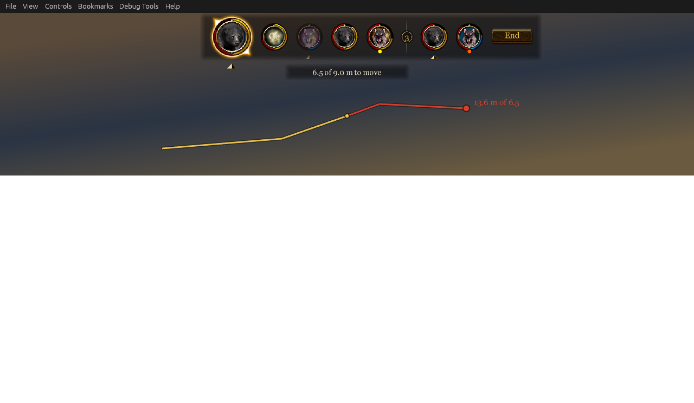

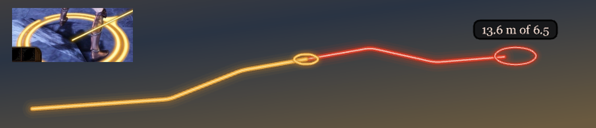

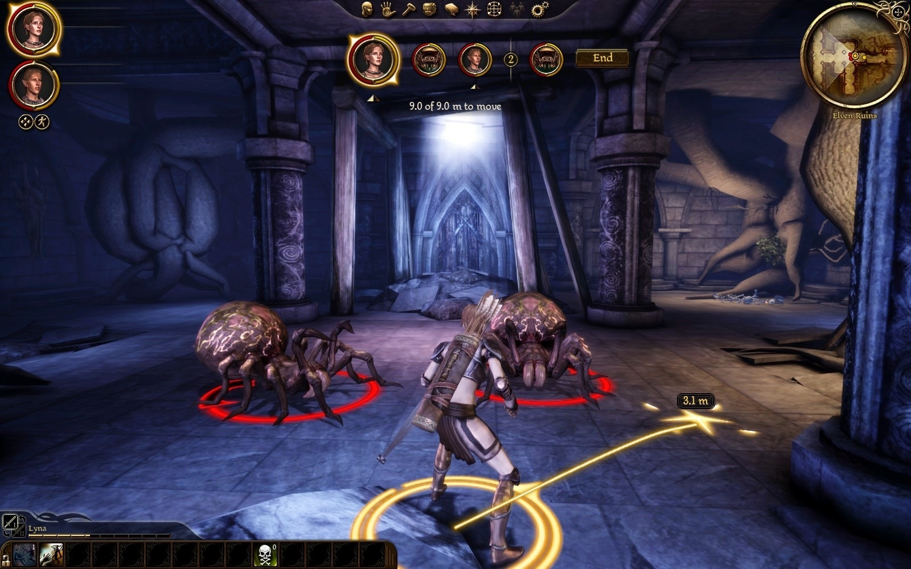

**Not the preview's:** after the game's window regains focus, a click at the pixel the mouse already rests on is no order, and the cursor has no ground there until the mouse moves, with the preview on or off (play test 17: what looked like the preview going after a refused click was this, the tester's capture tool handing focus back).

**The path on the ground** (`[feedback] move_preview_ground`, on: the user's choice of the two styles seen in play, 2026-10-01, "let's try the rings. We'll work on model / texture later if necessary"). The user: "should the line be drawn on the ground as well?" The movie's line lies over the scene, across the walker's own leg and over whoever stands in front of the path, beside a marker that is in the world. A line in the world is not to be had cheaply: an effect is scaled by one number, so no row can be stretched along a step, and a model of our own is days of work with tools that do not write one (lib-agent's reading; it is looking for a scale per axis). So, as a second style to judge in play: marks, the game's own selection rings made small (the party's gold `SR_PTY`, row 30005, in reach; the enemy's red `SR_EMY`, row 30011, beyond), one every 0.4 m along the path (`AlongPath`, `src/core/Preview.h`), each left out of the cursor's pick, beginning outside the walker's ring and stopping short of the marker; a too-far end has the red ring larger. The movie then draws only the length (the head's last field). Sixty marks at most: a long path's are spread. Seen in play (play test 19, at 0.14 of a ring's size and every 0.4 m): safe (the cursor's ground steady with nineteen of them under and near it, six clicks of six walked), nothing left behind, 56 to 61 frames a second, behind Lyna where the line lies over her, and a path at a glance close to the camera. But a mark is a thin outline, and beyond five or six meters a few pixels: on the lit floor the trail nearly goes, and the red ones and the red ring round a too-far end can hardly be made out, where the line is seen at once at any distance. Half as large again (0.21, every 0.5 m), they can be followed to the end of a 10 m path and chain together far off (the same play test's second look); the too-far end's ring at a creature's size was seen but read as an enemy standing there, so it is twice a mark. The line remains, with the setting off. A painted line on the ground wants a model and a texture of our own, left for later. **Smaller and more, and red past the limit** (the user, the same day: "wonder if we can make the rings smaller. A larger number of smaller rings is basically a dotted line"; "how about red rings and a red marker after the move limit? Then it's easy to see how long player can move"): a tenth of a ring's size every 0.2 m, 150 at most; seen in play as a chain of small gold rings that reads as a dotted line close to and a fine line at ten meters (play test 20). The red marker was tried and is not to be had by colouring: the movement marker placed in red (DAOLib's tint for a placed effect, `61e471e`) stayed gold, its material taking no tint, so a too-far end has a red ring and no star; a red star wants a texture and a row of our own, which the user left for later. A second try did no better (play test 21): lib-agent read that the tint is a material parameter, `mml_vUserColorMultiplier`, which only the `ReticalTint` semantic of the reticles' material `GeneralGui.mat` has, and that the marker's two material objects (`move_indicator.mao`, `move_icon.mao`) say `Default`; the mod shipped both with `ReticalTint` in the override folder, and the star placed in red was gold still. Not told apart: whether the game takes a material object from the override folder at all (the tester's session was refused the change to the player's folder that would have shown it), and whether the colour `Place` hands over reaches that shader, which has a second colour input, `aur_vExternalColor`, and has not been seen to take a tint on any row. Known since, by lib-agent's test the same evening: the aiming ring (row 30017), whose material object names `ReticalTint` as the game ships it, placed with a red tint came out in its own pale gold. So the colour that `Place` hands over does not reach the reticles' shader on any row, and the gold star was not the override's doing; whether the override folder is read for a material object was never needed. Both files and the red placement are out until DAOLib finds how that shader is given a colour (`aur_vExternalColor` is its other input). The red rings, a faint smudge as the plain enemy ring, are the targeted enemy's ring (row 30012), brighter and wider, and a little larger than the gold. Marks are moved only when their place has changed.

**The bar of time: the mod's own, under the medallions** (2026-10-02). With `[turns] clock = time`, on the player's turn, a bar under the turn order, beginning under the current card (the first), shows what is left of the turn: full as it begins, emptying as it is spent, a tick at every second and a longer pale one where a turn's own seconds end (past it the bar is what rolled over and Combat Tactics'). It is made of the game's experience bar's art by texture name, as everything here is: its dark ground (`CharacterRecord_I114`, 250 x 8) and its gold fill (`CharacterRecord_I117`, a strip stretched from the left), a fifth wider and half as tall again (`ui/turnorder`, `buildTime`, `drawTime`); the game's own nine ticks (`_I11B`) are left out for the mod's, one a second. **What the order under the cursor would cost is shaded on it**: the part of the gold it would spend pale, all that is left red when it does not fit and would land on the next turn.

It was the game's experience bar itself for half a day. The user asked "can we not reuse the gold experience bar already in the game?", and the plugin filled the game's bar through the quickbar's movie (`XPBar_mc.SetValue`) and shaded the cost on it with a script added to that movie in memory (DAOLib's `gfx::AppendDoAction` through `gui::OnMovieLoad`; it worked first time, play test 28). Seen in the game, the user: "the action bar seems to replace the experience bar? that's confusing. we should have it separate." Reuse meant the look. The game's bar is the game's again, nothing of its movie is touched, and `ui/quickbar` and its build step are gone.

Under the bar the caption says what the order under the cursor would cost (the preview's string: its seconds and whether it fits, from `core/Preview.h`'s `CostOf`): "Costs 1.9 s, leaving 1.2 s", "Costs 2.4 s: lands next turn", or with nothing under the cursor "3.1 s left, 14.4 m to walk"; a turn that began by paying for a kept action, or longer by what rolled over, says so while it is whole, the note standing with the seconds it is about: "5.0 s left (1.0 s rollover); 24.3 m to walk", "3.0 s left (1.0 s paid for last turn's action); 14.7 m to walk". (Until 2026-10-03 the note came last, "... m to walk (1.0 s saved from last turn)"; the user: 'Should say "4.3 s left (0.3 s rollover); 20.9 m to walk"'.) A move's cost is its walk; an attack's its walk and its swing; an attack on what is in reach its swing alone; a talent being aimed its own (`GameModeExplore::Targeting`). With nothing left of the bar and nothing pending it says "No time left: an action begun now lands next turn"; and while the player has the game paused (Space), on anyone's turn, "Paused: Space runs the game again" (play test 29: nothing on the screen said so; the game's own banner lies behind the bar, whose plate is solid while paused so that its tail does not show between the cards, play test 30).

**An order given back, said on the caption** (issue 21, 2026-10-03; the bar's string, version 10; seen in Ruffle and, 2026-10-03, in the game: Alistair's attack on a corpse with militia all round it at Redcliffe). When the engine refuses a party member's order once it is under way (a spell at a target behind a shut door, an attack with no room left round its target, no path), the machine gives the action back and the caption says why and that it is given back, in the game's gold: "A door is in the way: Morrigan's ability is given back", "No room at the target: Sten's attack is given back". It stands in place of what the turn has left and before what the order under the cursor would cost, since the cursor is still on the target the order was for; a card's name under the pointer still comes first. It stays five seconds of the real clock (`TurnMachine::kNoticeMs`) or until the player's next order is let through. The same reason floats over the character, as it did. The words are core's (`src/core/GivenBack.h`, by the engine's command results as DAOLib names them), and the line is the machine's view's `notice`. The movie's `notice=1` shows one outside the game.

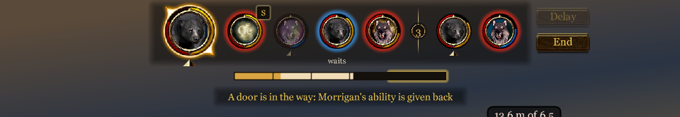

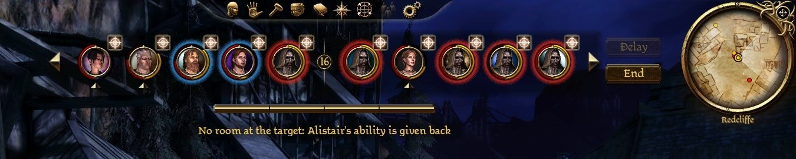

**A pending action on its creature's card** (the bar's string, version 8). A talent or a spell that did not fit its user's bar lands on its next turn: its own icon stands at the card's shoulder, the picture the quickbar shows for it (the abilities table's `icon`, loaded as the quickbar's movie loads it; `src/game/Bar.cpp` looks it up, with the ability's name), with a soft light behind it to lift it off the portrait. Under the pointer the card says "Lyna: Chain Lightning lands 1.0 s into its next turn", and so does the caption with the cursor on the creature itself (the preview's string, version 5: the creature under the cursor). A pending plain attack shows the game's own icon for an attack the same way (`ic_attack`, what its party bar shows beside a portrait while its creature attacks: the data tree's `Party.Members.<n>.CurrentActionIcon`, read from the running game 2026-10-03). It had no mark from play test 28 ("with four spiders every card had one, noise and not news") until the user asked for it with a turn a bar of time, where most turns end on a kept attack: "There's an icon for plain attack. What actor has that queued up for the next round, that should also indicate in the top right hand corner of the portrait, as with a pending talent" (issue 15). How the icon came to this, the user's words the same morning: first a number of seconds in a ring the script drew ("crudely drawn. they can use the same golden ringed circle as the turn separator"), then "what if we used the icon of the talent / spell instead of a number? the number doesn't really tell us anything", "no gold ring needed i think, just icon. maybe icon should have a slight glowing border", and "a bit smaller ... maybe 75%".

**End and Delay** (play test 28). On a party member's turn End stands at the strip's end; where Delay is offered (`[turns] delay`) the two stand one over the other through the whole turn, Delay greyed once it is not to be had (something spent, the turn put off already, nobody to wait for), so that End does not move under the hand: it dropped to the middle as Delay went, and a click where it had been missed it. Delay is the upper and End the lower (the user, 2026-10-03, issue 9; End was the upper until then): End is pressed nearly every turn and the lower place is the nearer to the battlefield, and Delay, to be had only before anything of the turn is spent, is its first choice. A click sends `TB_EndTurn` or `TB_Delay`. A creature that has put its turn off has "waits" under its card until the turn comes: the floaty over it was gone with the camera in the frame it was shown.

"waits" stands close under its card's ring, clear of the bar: where the party's gold arrow stood until issue 25 (the user of that arrow, 2026-10-02: "should be higher up closer to portrait, it's overlapping w/ the action time bar").

**Whose side a card is on: a glow behind it** (issue 13, 2026-10-03). The user, with twelve in the order at Redcliffe's square, militia and walking corpses under the same gold ring: "Can we put a red glow around the portraits of enemies? I think in the very beginning we had big orange ring around it, make it a red glow instead. And a blue glow around allies that are not the party." Red behind an enemy's medallion, blue behind an ally's that is not of the party, and, since issue 25, yellow behind the party's. The red and the blue are those of the rings the game draws on the ground under them. **The party's yellow** (issue 25, 2026-10-03): until then the party had no glow and its mark was a gold arrow under each card the player commands. The user: "Should we have glowing yellow circles around the party portraits instead of the arrows? It would match the selection circles, just as blue and red match the allies and enemies", and, of the two side by side in the movie's sample, "Yeah go with that". So all three sides read by one rule, and the space under the cards is left to "waits" and the bar of time. The yellow (`0xFFD21E`) is chosen by eye to stand off the cards' gold rings and the current card's gold frame, not read out of the game. It is by side: a companion playing by its tactics (`party = tactics`) has it too, where the arrow was only for the cards the player commands. GFx 3 has no filters for shapes, so the glow is five rings drawn wider and fainter outwards under all of the medallion's art (`drawCard`): the gold ring and the arcs are as they were.

**The bar shows ten turns ahead** (issue 14, 2026-10-03; twelve before). With twelve cards Delay lay under the minimap and End's end with it. The user first asked for the portraits a little closer ("not too much though or else it'll look too cramped"), and for an hour the cards stood 3 apart and a long strip gave way to the left of the middle to keep its buttons clear. Then: "Maybe instead of shifting the portraits we have 10 instead of 12? ... Large fights like these are going to overflow anyway, 12 is not even enough to show everything", and "let's make it 10". So the bar shows ten (core's `TurnView::kShown`), the cards stand 5 apart as before, and the strip is always centred: at 1600 x 1000 its buttons end some 45 screen pixels short of the minimap. The movie's `sample=many` shows ten outside the game.

**More fighting than the row holds: an arrow at each end** (issue 23, 2026-10-03; built, seen in Ruffle, not yet in the game). With more than ten in the order the rest were on no card and in no count: at Redcliffe castle one fighter was always off the bar's end, and a tool that read the order lost a party member for four rounds. The user: "What if we had arrows to the left and right of the ends of the portraits, I think there are some golden arrows in the game zone resources. Clicking on the right arrow moves down the list and shows portraits beyond 10. Left arrow moves back. No arrows should be shown if there are 10 or fewer portraits. If unable to move last or right, the corresponding arrow is hidden. As gameplay continues, don't want to constantly reset the position of the portraits back to the beginning. If we're currently showing 3 to 12 (starting at index 1), continue showing those positions, starting at 3. If an enemy in position 1 or 2 has fallen, then the index is at 2. If both enemies before has fallen, then the index is now 1. Take screenshots to make sure that the arrow doesn't overlap with the delay and end buttons. Reduce spacing between portraits from 5 to 4 if necessary to make them fit."

- **Where the row stands is core's** (`src/core/BarWindow.h`; the game layer's `BarLink` keeps one and follows the machine's view with it every frame). The row's first place among the turns to come is kept from view to view: the list turns as turns pass, and the row goes on showing the same places, not the same fighters. When one standing before the row leaves the list (a fallen enemy goes from it at once; a fallen party member stays, greyed) the row begins a place earlier, which keeps it on the fighters it showed. It never runs past the list's end, so with ten or fewer it is the beginning; a fight's end sends it back there, and a conversation in the middle of a fight leaves it. One joining leaves it at its place.
- **The machine's view has every turn to come** (`TurnView::upcoming`; it was cut to ten), and so has the state a tool reads (`turnbased.state`'s `order`) and the bar's string, whose head says how many stand before the row, how many it shows and how many come after. The movie draws the row; an arrow shows at an end with any beyond it.
- **A click** sends `TB_Scroll` with 1 or -1 and moves the row one card (`BarWindow::kStep`; one is not the user's number, who gave none). The plugin takes it on its next frame and publishes the view at once, and the movie asks every frame for six after a click, where it asks three times a second otherwise: the row moves in a frame or two. Under the pointer an arrow says how many more lie that way ("4 turns after these").
- **The art** is the level-up screen's golden arrows, the pair that lowers and raises an attribute (`levelup.gfx`'s `AttributePlusButton` and its twin, in `chargen.gfx` too): `levelUp_I9B` to earlier turns, `levelUp_I94` to later, each a 40 x 40 texture with the gold 14 wide and 25 tall in it, drawn at its own size; under the pointer the game's glowing outline of each (`levelUp_I9E`, `levelUp_I96`) over it, and pressed it moves a pixel down and right, as the game's does. All four are in the shared atlas (`atl_shared_dxt5`), beside the cards' own `levelUp_I158`. Should one not load in the game: the abilities screen's character arrows, `abilities_IA7` and `abilities_IB5` (35 x 30, `abilities.gfx`'s `charselctL_m`), then the journal's, `journal_IDC` and `journal_IE2` (42 x 42); the numbers for each are at `ARROWS` in the movie's script.
- **The layout.** With more than ten fighting the row has a track as wide as a row can be (ten cards, the current one's size and one round's divider: 706 of the stage's pixels) and stands in the middle of it; the arrows, the plate and the buttons go by the track. So nothing but the cards moves as the row is moved, and an arrow that is hidden for the moment keeps its place: by the row's own width, which is 61 less without the current card and a divider, an arrow would move 30 from under the pointer at a click, and End and Delay with it. An arrow stands 6 from the track, level with the cards' middle, which is below the shoulder where a pending action's icon stands on the last card; End and Delay begin 8 after the right arrow, 28 from the track where they are 20 from the cards with no arrows. At the widest they end 8 further right than they did: at 1600 x 1000, 31 screen pixels short of the minimap's frame, where they were 41 short. The cards' gap stays 5: the pictures did not ask for 4. What the hand meets is a box about the gold, 22 by 27 and filled too faintly to see, not the texture's 40 x 40, which would take the clicks of the card and the buttons beside it.
- **Portraits** are got for the row's cards alone, one with each view as before, so a fight of thirty has ten rendered until the row is moved, and each of the rest once when the row comes to it; all are released at the fight's end as they were.
- **Seen in the game** (2026-10-03, Redcliffe's square at night, fifteen in the order, at 1600 x 1000): the four textures load by these names; a real click on either arrow is the bar's and moves the row one card, with nothing in the world behind answering it (the computer-use session's mouse; the first click after the window had been moved only gave it the focus); under the pointer the caption counts ("5 turns before these", "2 turns after these"); at the list's end the right arrow goes, its place stays empty, and End and Delay stand on the same pixels throughout, their right end some 37 screen pixels short of the minimap's frame; as fighters fell the row stayed on the same fighters (the log: "the turn bar's row shows turns 2 to 11 of 12 (moved with the order: one before it gone, or the list shorter)"). The movie's `sample=more` is fourteen fighting, with `first=<n>` to put the row further along, `turn=ai` for somebody else's turn, and, for a picture with no hand on the mouse, `point=later` or `point=earlier` (the pointer on that arrow) and `click=later` or `click=earlier` (one click on it): `.\tools\snapshot.ps1 -Sample more -Set first=2,click=later`. Its arrows work in the player. Seen so in Ruffle: the pointer's glow and count, and a click moving the row a card each way and hiding the arrow at either end; those go through the arrow's own handlers, not through the mouse, so what the mouse meets is not shown by them.

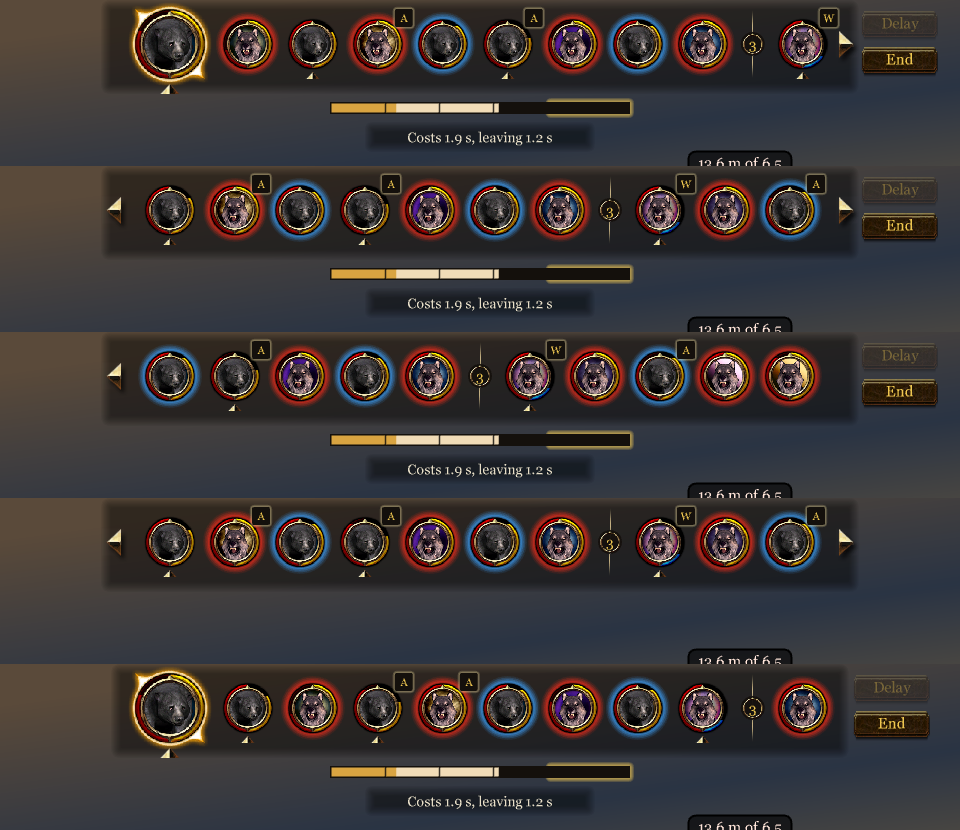

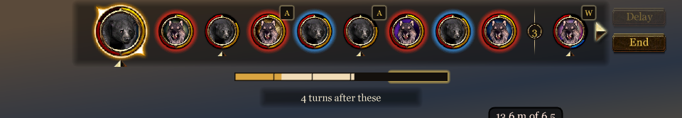

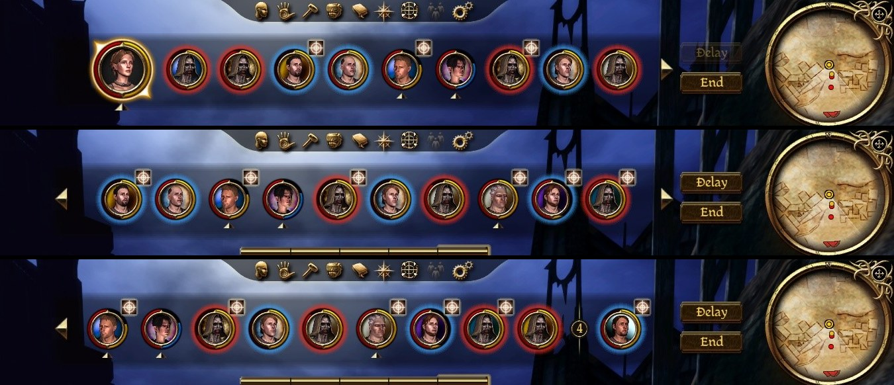

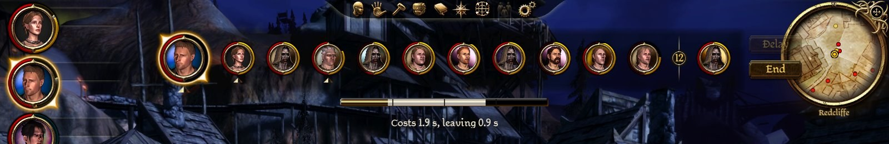

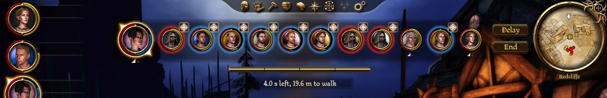

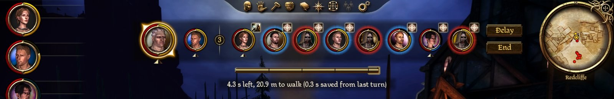

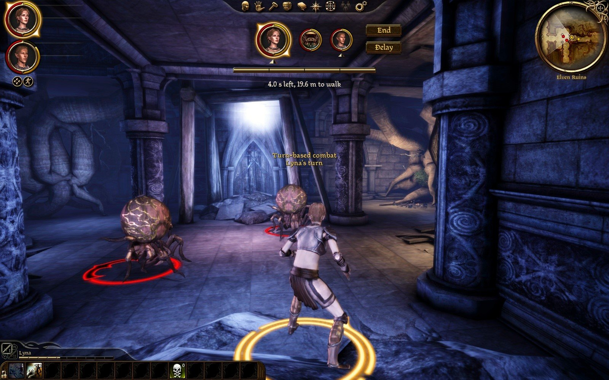

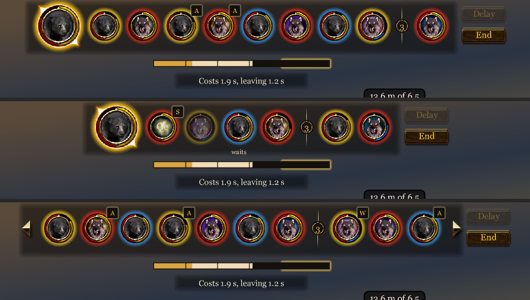

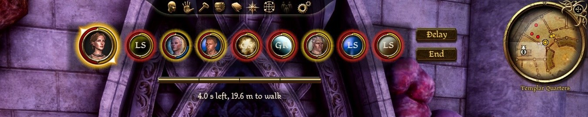

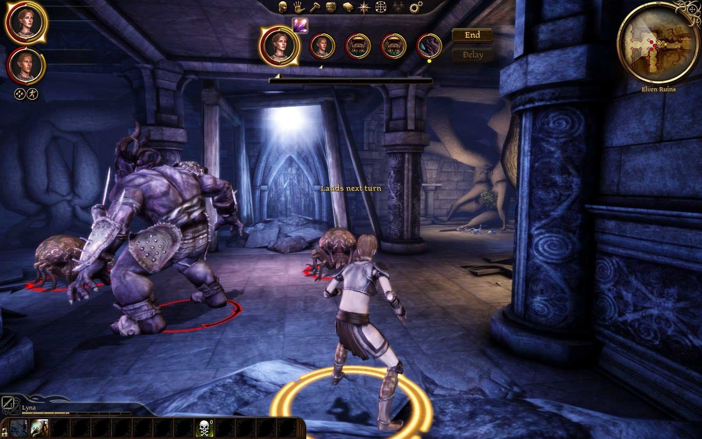

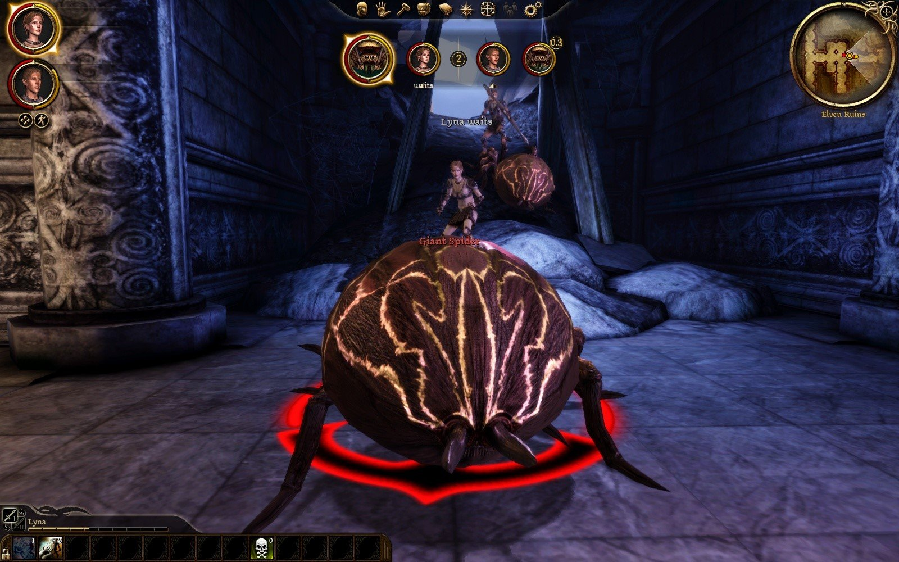

**An attack's walk** (built 2026-10-01, seen in play 2026-10-02; the user's first list: "the same for an attack: gold if the target can be reached this turn, red if not, before the player clicks"). With the cursor over an enemy and an action left, the path is the one an attack would walk: the game's path to the target, as far as where the attacker can strike, which is the engine's own answer and the number the gate judges the attack by (DAOLib's `dao::attack::Walk`, since 2026-10-04, issue 11), gold within the movement left and red past it, the length over its end. No marker and no ring at its end: the target has its own. Nothing is drawn for a target in reach where the attacker stands (an archer's, mostly), nor over a door, a chest or a friend.

**Found in play and mended (play tests 23 and 24):** the attacker walked about a metre further than the plate said: the reach was the AI's judgement of a melee target, 3.5 m, and against a giant spider Lyna struck from 2.4 m (plate 1.8 m, walked 2.8 m; plate 4.9 m, walked 6.0 m). The reach is now where the engine's own walk to strike ends, read in the exe by DAOLib: both creatures' personal space, 1.2 m and the swing's 0.15 m of play (`core/Rules.h`, `Reach`). Seen in play test 24 on three sizes, a spider (reach 2.4 m), a skeleton (2.1) and a black bear (2.7): walked 1.9, 3.4 and 3.5 m against plates of 1.9, 3.3 and 3.6, and a too-far bear refused with the plate's own number (`dev/PLAYTEST-2026-10-02-24.md`).

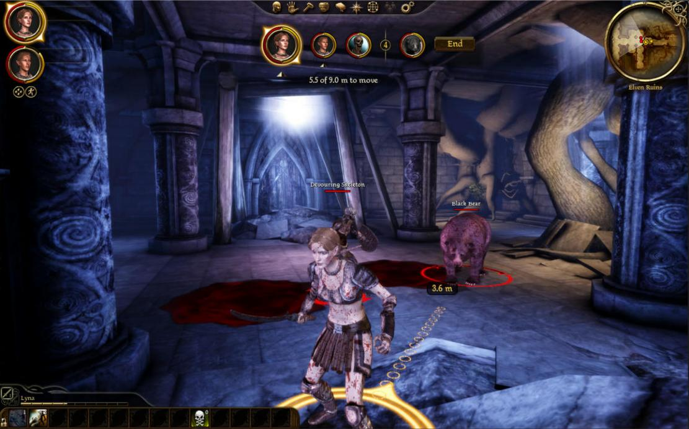

**Still to do:**

- a ring around the character, its radius the movement left;
- a continuous line on the ground, if DAOLib finds a way to stretch an effect along a step; until then the marks above.

## The switch

The game's Options screen (`optionsmenu.gfx`) with a "Turn-based combat" toggle beside auto-pause, disabled while in combat. It needs the movie extended (an override of `optionsmenu.gfx`, or a page added through it) and the value read back. Until then, `Ctrl+T` and `turnbased.ini`. Decided 2026-10-01: a "Turn-based" section of its own on the Game tab, with the toggle (the user's call; DAOLib found room in both of the tab's columns, and `dao/Options.h` places the game's own checkbox there by patching the options movie in memory as the game opens it; the mod gives it `get` and `set`, `src/plugin/Plugin.cpp`'s `AddOptions`). The key is in the game's Controls tab already, under "Turn-based" (`dao/Input.h`).

## The tactics page's box (issue 46; not built)

"Use when turn-based", a box a character on the game's tactics page: ticked, that companion's tactics play its turns in a turn-based fight; off by default; changeable in a fight, from the companion's next turn; none on the hero's page in the first version (the user, 2026-10-05; `dev/DESIGN.md`, "Whose tactics play its turns"). The choice it makes is built and kept with the saves, and until the box is there a test tool makes it (`turnbased_auto`). The box is to be the mod's own element, of the game's checkbox art with a caption, beside the page's own controls and changing none of them. What it needs is DAOLib's to find (`dev/DAOLIB_NEEDS.md`, "The UI", item 5): when the tactics screen is up and whose tactics it shows, a way to draw over it or to add a control to it as the options' section was added, and the click.
